# MiLily, a set of universal PCR primers for metabarcoding environmental DNA from **sea lily**

[中文](README.zh-CN.md)
[Download the pre-optimization Method PDF (historical snapshot)](publications/MiLily_Method_ResearchGate.pdf)

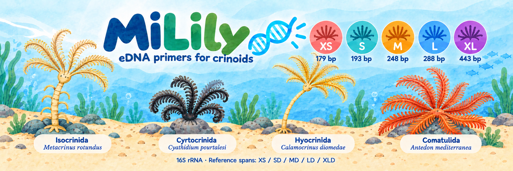

Badge values are primer-inclusive reference spans on AF049132.1: XS 179, S 193, M 248, L 288 and XL 443 bp. XS products in the full target-reference scan are 159–194 bp; the common 27-reference panel spans 178–194 bp.

## Abstract

MiLily comprises five candidate mitochondrial 16S rRNA windows for crinoid eDNA: XS, S, M, L and XL. Primary metrics weight four orders equally using 27 references, 25 taxonomic labels and 7,177 background records. Revised SD, MD, LD and XLD achieve order-balanced coverage of 71.59%, 100%, 50% and 75%, and exact matching of 43.18%, 50%, 14.77% and 68.18%, respectively. Each D is a single pair sharing its ordinary/A/B endpoints. XS remains a fixed short-window candidate with separately reported background and structural predictions.

## Introduction

MiLily targets mitochondrial 16S rRNA for metabarcoding Crinoidea, including stalked sea lilies and feather stars. Living crinoids include Comatulida, dominated by feather stars, and the predominantly stalked Isocrinida, Hyocrinida and Cyrtocrinida. Multigene and phylogenomic studies reveal a complex history of stalked and stalkless body plans, with morphological similarities not always tracking relationships. [Rouse et al., 2013](https://doi.org/10.1016/j.ympev.2012.09.018); [Rouse et al., 2026](https://doi.org/10.1098/rsos.251924)

Molecular phylogenetics and taxonomic revisions of Comatulidae further demonstrate the value of combining morphology, sequences and updated names for identification. [Summers et al., 2014](https://doi.org/10.1016/j.ympev.2014.06.030); [Summers et al., 2017](https://doi.org/10.11646/zootaxa.4268.2.1) These studies provide the taxonomic context for organising MiLily references by lineage, interpreting matching differences and maintaining species labels.

MiFish provides a design precedent: primers anchored in conserved regions flank a short variable marker, with MiFish-E accommodating binding-site variation in a particular lineage. [Miya et al., 2015](https://doi.org/10.1098/rsos.150088)

Mini-barcode studies demonstrate the utility of short fragments for degraded DNA and the value of comparing the taxonomic information retained by different windows. [Meusnier et al., 2008](https://doi.org/10.1186/1471-2164-9-214); [Boyer et al., 2012](https://doi.org/10.1371/journal.pone.0038215) MiLily therefore retains XS, S, M, L and XL windows and compares amplicon length, target coverage, exact matching and non-target hits.

Marker selection involves both taxonomic coverage and discrimination. ecoPrimers evaluates these dimensions alongside length constraints and target/non-target reference sets. [Riaz et al., 2011](https://doi.org/10.1093/nar/gkr732) MiLily adopts this comparative approach, fixing the binding coordinates within each S–XL window while evaluating ordinary single pairs, complementary A/B pairs and degenerate D pairs to accommodate sequence variation with few primer combinations.

## Methods

### Reference data and matching criteria

Coordinates are 1-based on the extracted, ungapped AF049132.1 16S sequence. This reference represents *Florometra serratissima*, whose complete mitochondrial genome and gene arrangement were described by Scouras and Smith. [Scouras & Smith, 2001](https://doi.org/10.1093/oxfordjournals.molbev.a003720) The target FASTA contains 269 records. Headline comparisons use the frozen common panel with equal order weighting; the earlier within-label reference-weighted metric is retained as a secondary comparison.

Coverage requires ≤2 mismatches per primer and IUPAC-compatible terminal 3 nt; exact matching requires zero mismatches at both ends. The background contains 7,177 non-target records. WC3, GT2 and WC4 count paired hits with ≤3 mismatches per primer, ≤2 under a G–T pairing model, and ≤4, respectively; these permissive screens do not require terminal-3 compatibility. Strict background matching separately applies the target coverage criterion. Non-target hits are reported as reference-record counts.

### Candidate design and verification

Ordinary, A, B and D alternatives share identical forward and reverse boundaries within each S–XL window. Single pairs are preferred where sufficient. A/B denote separate-PCR unions, retained only when both components contribute unique coverage or exact matches. D denotes a single degenerate pair. XS was evaluated independently as a supplied fixed pair.

Terminal checks require no terminal homotriplet, at least one GC in the final 3 nt, 1–4 GC in the final 5 nt and no homopolymer longer than four bases; 3′ degeneracy is allowed. Duplex, hairpin and dimer thermodynamics are calculated with Primer3. [Untergasser et al., 2012](https://doi.org/10.1093/nar/gks596) Calculations use 50 mM monovalent salt, 1.5 mM Mg²⁺ and 0.6 mM dNTP, at 50 nM per variant and 200 nM total per direction. S–XL require structure Tm <55°C and a forward/reverse duplex-Tm midpoint difference ≤5°C. This D search allows ≤100 broad WC3/GT2 and ≤20 strict WC/GT records each, with degeneracy ≤128 per direction; ordinary/A/B retain their original limits. XS is evaluated separately as a fixed-sequence scheme.

Exhaustive full-sequence scans check both strands, paired orientation and distance, followed by independent algorithmic verification. Full parameters and execution instructions are available in [Methods](docs/METHODS.md) and [Reproduction](docs/REPRODUCIBILITY.md).

## Results

### Windows and matching performance

Primary metrics average label detection equally across four orders. A label is detected when any of its references matches. The common panel has 27 references and 25 labels: 22 Comatulida and one per other order; it is not a complete species inventory. Exact matching uses the same hierarchy.

| Scheme | Order coverage % | Order exact % | WC≤3 | GT≤2 |
|---|---:|---:|---:|---:|
| XS | 100.00 | 98.86 | 4196 | 3889 |
| SD | 71.59 | 43.18 | 4 | 7 |
| S | 19.32 | 7.95 | 0 | 0 |
| SA+SB | 19.32 | 13.64 | 0 | 0 |
| MD | 100.00 | 50.00 | 26 | 23 |
| M | 48.86 | 0.00 | 4 | 1 |
| MA+MB | 48.86 | 5.68 | 4 | 0 |
| LD | 50.00 | 14.77 | 0 | 0 |
| L | 25.00 | 9.09 | 0 | 0 |
| LA+LB | 25.00 | 13.64 | 0 | 0 |
| XLD | 75.00 | 68.18 | 8 | 3 |
| XL | 67.05 | 2.27 | 0 | 0 |
| XLA+XLB | 69.32 | 5.68 | 0 | 0 |

[D优化与类群增减 / D optimization and label changes](docs/D_OPTIMIZATION.md)

The secondary table below retains the earlier within-label reference-weighted metric.

| Scheme | Coverage % | Exact % | WC≤3 | GT≤2 | WC≤4 |
|---|---:|---:|---:|---:|---:|
| XS | 100.00 | 96.00 | 4196 | 3889 | 4405 |
| SD | 84.00 | 66.00 | 4 | 7 | 151 |
| S | 66.00 | 28.00 | 0 | 0 | 0 |
| SA+SB | 66.00 | 46.00 | 0 | 0 | 0 |
| MD | 100.00 | 92.00 | 26 | 23 | 47 |
| M | 88.00 | 0.00 | 4 | 1 | 11 |
| MA+MB | 88.00 | 20.00 | 4 | 0 | 14 |
| LD | 92.00 | 50.00 | 0 | 0 | 0 |
| L | 88.00 | 30.00 | 0 | 0 | 0 |
| LA+LB | 88.00 | 46.00 | 0 | 0 | 0 |
| XLD | 96.00 | 70.00 | 8 | 3 | 163 |
| XL | 68.00 | 8.00 | 0 | 0 | 6 |
| XLA+XLB | 76.00 | 18.00 | 0 | 0 | 6 |

Independent verification covers 918 target decisions and 34 background-set checks with zero disagreements. A wider target-product-length scan leaves the XS headline metrics unchanged. The release contains 13 portfolios, 17 pair records and 34 oligos.

[Retention decisions / 保留决策](docs/DECISIONS.md) · [A/B complementarity / 互补性](docs/AB_COMPLEMENTARITY.md)

### Primer performance

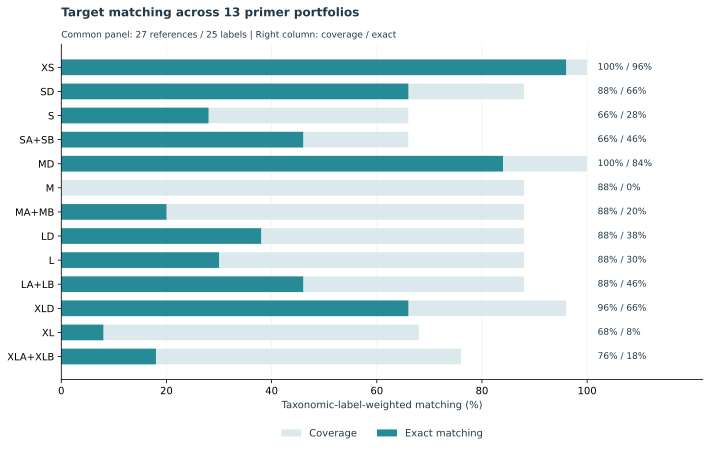

**Figure 1 | Target matching.** Pale bars show coverage and dark bars exact matching; the right column gives coverage / exact percentages. All portfolios use the same 27-reference, 25-label panel with equal order weights. A/B denotes the union of separate PCRs.

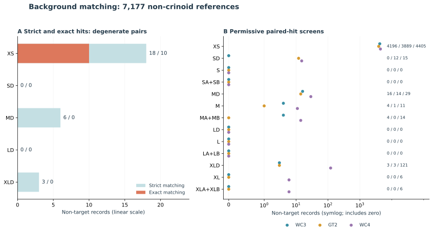

**Figure 2 | Non-target matching.** A: strict and exact record counts for XS and the S–XL degenerate single pairs, labelled strict / exact. Strict matching requires ≤2 mismatches per primer and compatible terminal 3 nt. B: permissive WC3, GT2 and WC4 paired-hit counts for all portfolios, on a symlog axis that includes zero; the right column lists the three counts in that order. The background contains 7,177 records.

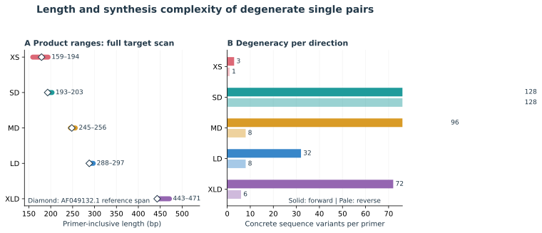

**Figure 3 | Length and synthesis complexity.** A: predicted primer-inclusive product ranges from the full target-reference scan for XS and the S–XL degenerate single pairs; diamonds mark AF049132.1 reference spans. B: numbers of concrete sequence variants per primer, with solid bars for F and pale bars for R.

### XS

XS is retained as a short-amplicon candidate for experimental validation: one pair, F/R degeneracy 3/1, and predicted products of 159–194 bp across the full target-reference scan (178–194 bp on the common panel). Its primer-inclusive span on AF049132.1 is 179 bp. D in the F sequence denotes A/G/T; the assay name is XS.

| Name | F (5′→3′) | R (5′→3′) |
|---|---|---|
| XS | `TTGGGGCAACCDCGAAG` | `CAACATCGAGGTCGCAAAC` |

XS passes terminal rules and has compatible duplex Tm ranges. Its three F variants predict internal short hairpins with Tm 62.6–69.4°C, above the 55°C structure gate used for S–XL; the primer 3′ end lies outside the stem. Under the strict target-matching criterion, XS still matches 18 non-target records, including 10 sea-urchin records matching both primers exactly. At 57°C, predicted internal-hairpin ΔG is approximately −0.35 to −0.65 kcal/mol.

[XS assessment and evidence](docs/XS.md) · [Base table](results/xs/base_matching.csv) · [Independent verification](results/xs/background_verification.json)

### S

| Name | F (5′→3′) | R (5′→3′) |
|---|---|---|
| SD | `GATCTAMTRMWAYYCCRA` | `TRTCCCTKTTRRTYTWRC` |
| S | `GATCTAATGAAACCCCAA` | `TATCCCTTTTGGTTTAGC` |
| SA | `GATCTAATGAAACCCCAA` | `TATCCCTTTTGGTTTAGC` |
| SB | `GATCTAATGAAACCCCAA` | `TGTCCCTTTTGGTTTAGC` |

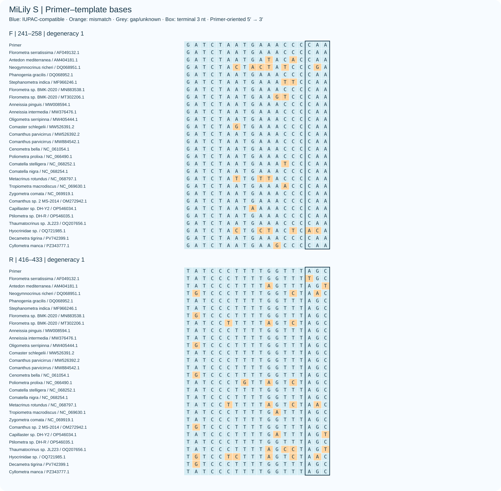

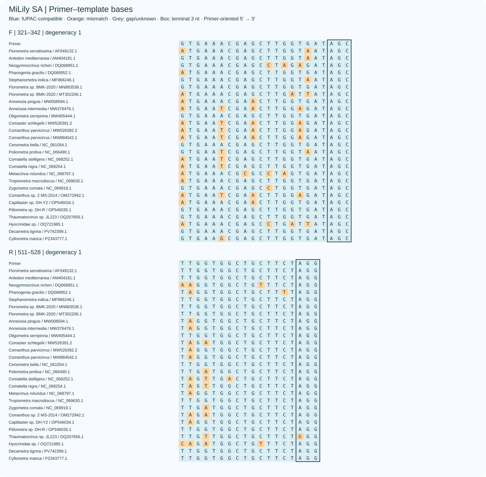

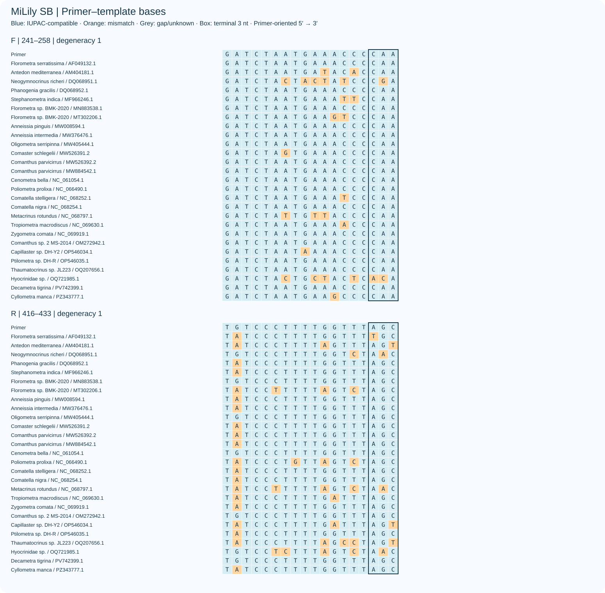

### M

| Name | F (5′→3′) | R (5′→3′) |
|---|---|---|
| MD | `TYACTGTTDCAAAAGTRAAYWAAGAR` | `GRCTGCTTYTRGGCCTAC` |
| M | `TTACTGTTGCAAAAGTAAACTAAGAG` | `GGCTGTTTCTAGGCCTAC` |
| MA | `TTACTGTTACAAAAGTAAACTAAGAG` | `GGCTGCTTCTAGGCCTAC` |
| MB | `TTACTGTTGCAAAAGTAAACTAAGAG` | `GACTGCTTCTAGGCCTAC` |

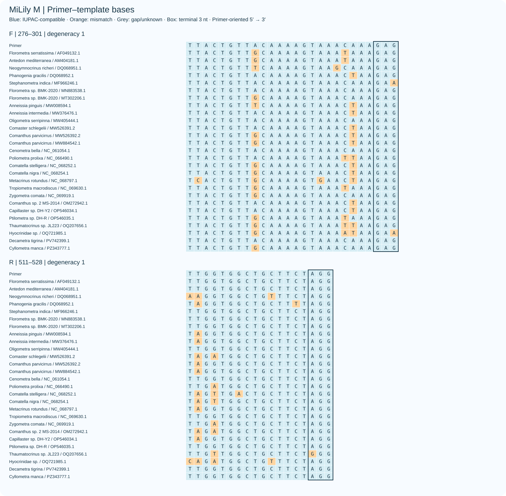

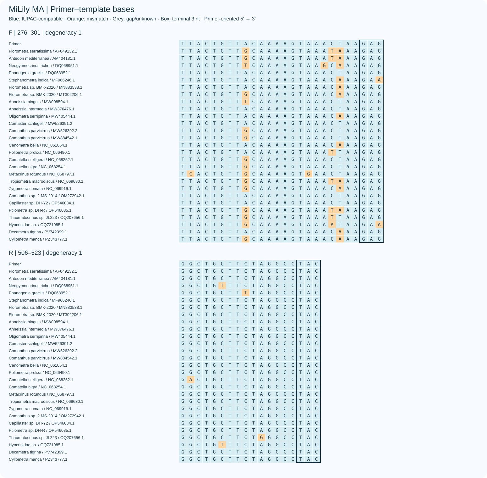

### L

| Name | F (5′→3′) | R (5′→3′) |
|---|---|---|
| LD | `YARGAGATCTAATGAWAYYCCA` | `GRCTGCTTYTRGGCCTAC` |
| L | `CAAGAGATCTAATGAAACCCCA` | `GGCTGCTTCTAGGCCTAC` |
| LA | `CAAGAGATCTAATGAAACCCCA` | `GGCTGCTTCTAGGCCTAC` |
| LB | `CAAGGGATCTAATGAAACCCCA` | `GGCTGCTTCTAGGCCTAC` |

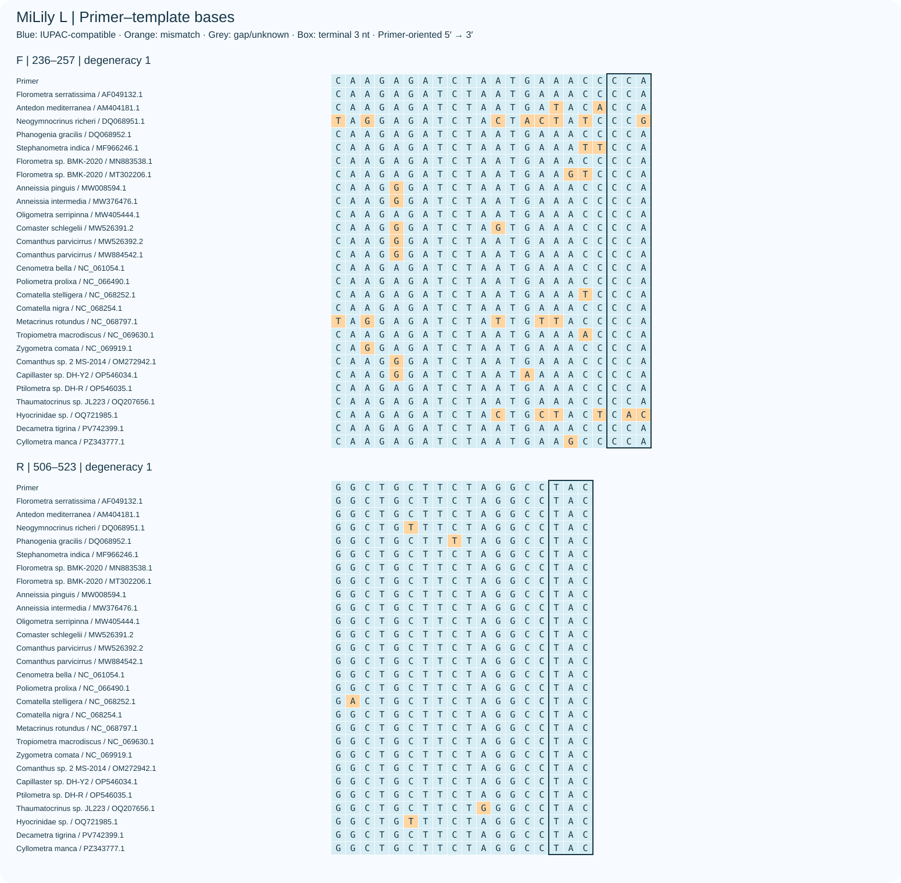

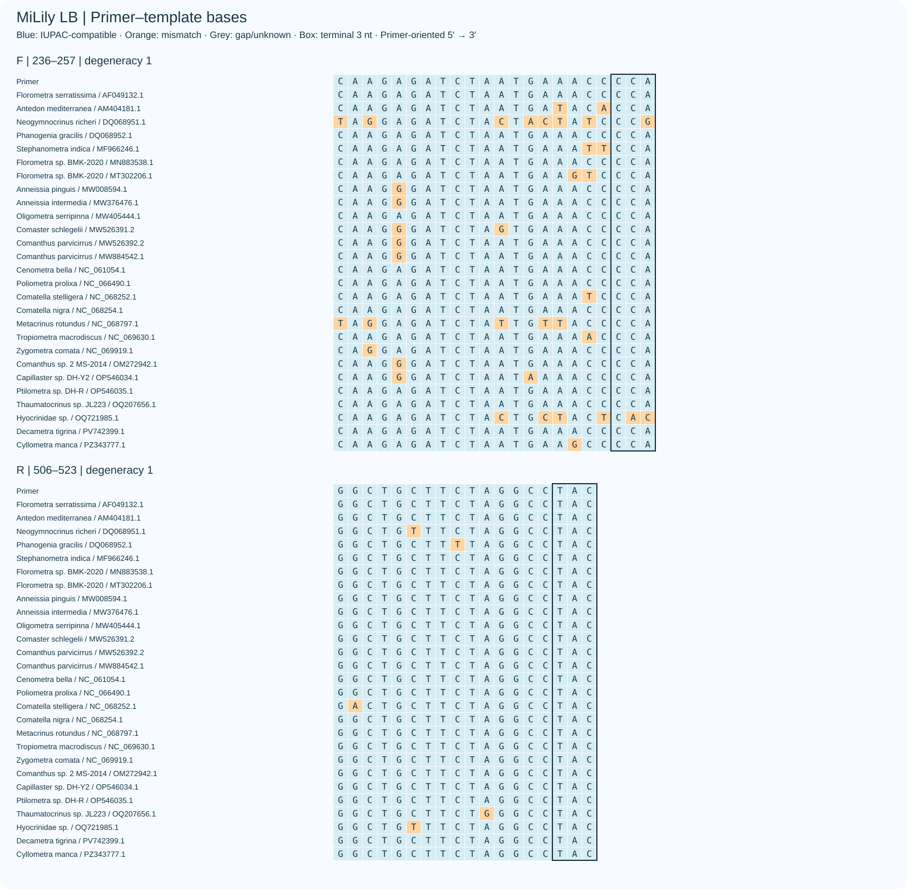

### XL

| Name | F (5′→3′) | R (5′→3′) |
|---|---|---|
| XLD | `AGGCAAVACGARRRCTHAACTG` | `GACTYDCGTCGGTCTGAA` |
| XL | `AGGCAAGACGAAAGCTTAACTG` | `GACTTGCGTCGGTCTGAA` |
| XLA | `AGGCAACACGAAAACTTAACTG` | `GACTTGCGTCGGTCTGAA` |
| XLB | `AGGCAAGACGAAAGCTTAACTG` | `GACTTGCGTCGGTCTGAA` |

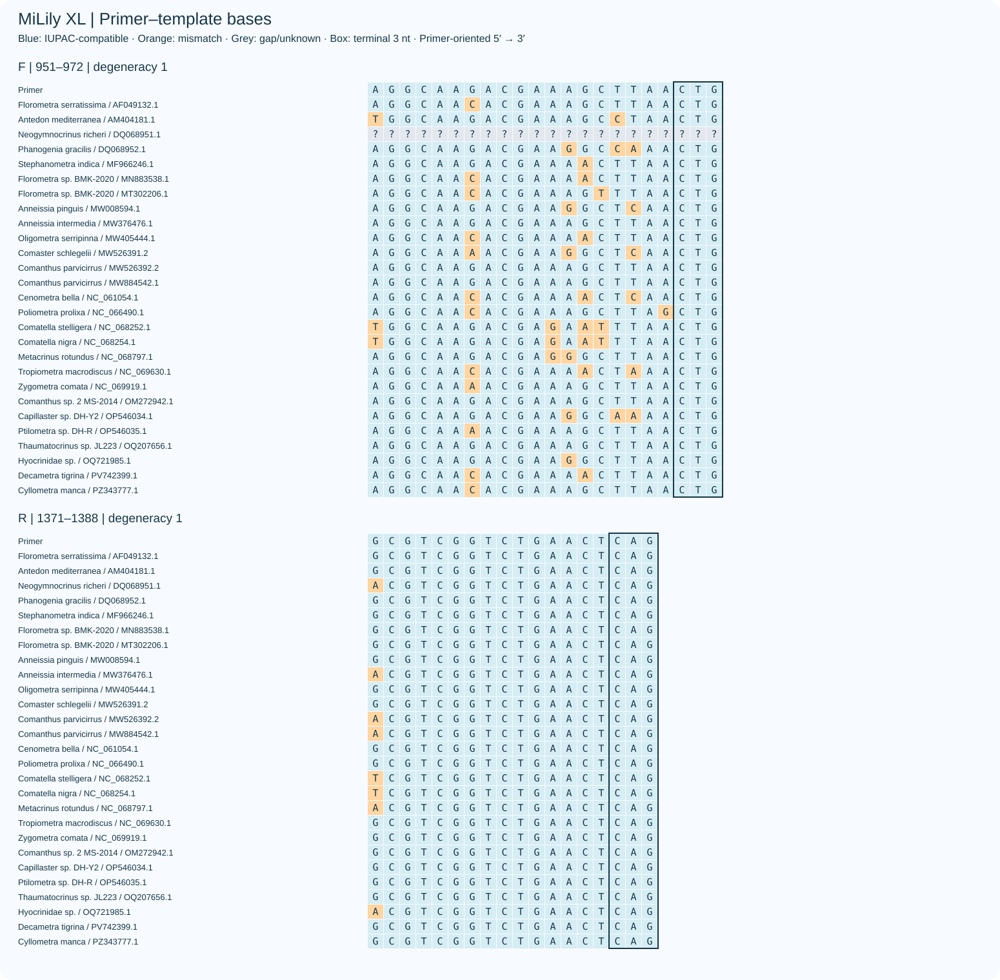

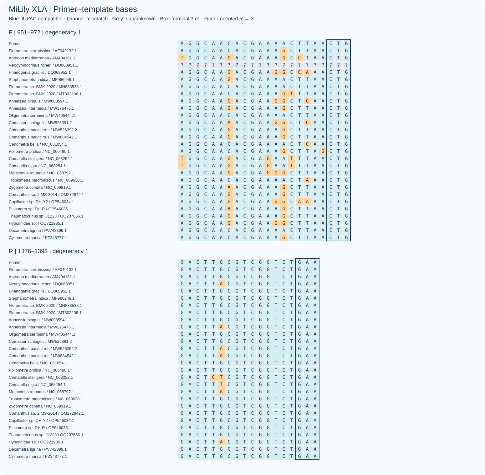

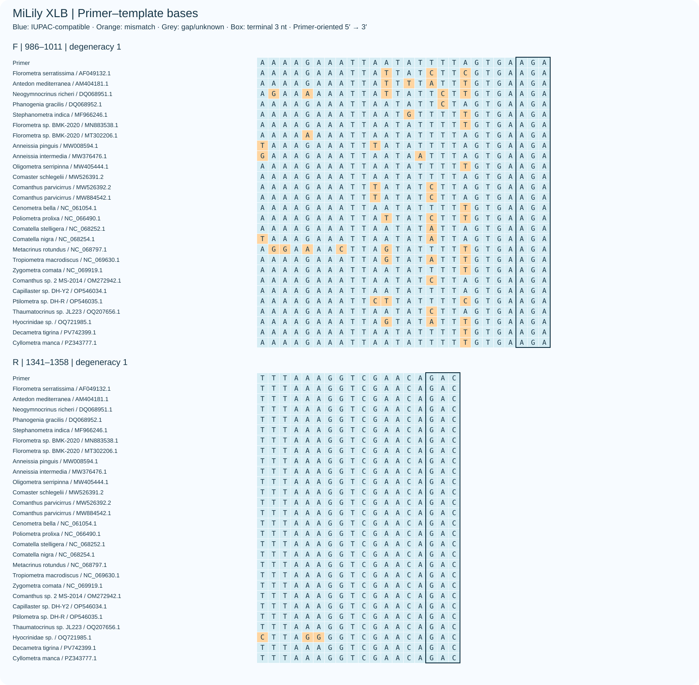

## Discussion

XS achieves 100% coverage and 98.86% exact matching under order weighting with F/R degeneracy of 3/1, making it a priority for short-amplicon testing. MD also covers the complete common panel and yields fewer permissive background hits. The two schemes offer different tradeoffs: XS emphasises short products and low degeneracy, whereas MD balances coverage and background discrimination. Of the 18 strict non-target XS hits, 10 sea-urchin records match both primers exactly and have predicted products overlapping the crinoid size range. Mixed samples containing sea-urchin DNA are therefore a useful test of competitive amplification.

MiFish accommodates lineage-specific binding variation with an additional primer variant, a principle relevant to complementary MiLily combinations. [Miya et al., 2015](https://doi.org/10.1098/rsos.150088) In MiLily, S, M and L unions primarily improve exact matching, whereas the XL union also improves coverage. Retention depends on each component's unique contribution. Shared coordinates among ordinary, A, B and D alternatives keep within-window comparisons focused on binding-sequence differences.

XS has 22/25 labels without observed shared barcodes (88%) on the common panel, the same as the pre-optimization MD. Discrimination depends on the variation captured by a window, supporting joint evaluation of marker length and barcode information. [Boyer et al., 2012](https://doi.org/10.1371/journal.pone.0038215) The present results are computational evaluations on shared reference data; subsequent tissue, defined-mixture and environmental tests will compare amplification efficiency and detected composition. Controlling mixture inputs is particularly useful because metabarcoding experiments have found substantial read-count differences among taxa with similar biomass. [Elbrecht & Leese, 2015](https://doi.org/10.1371/journal.pone.0130324)

Expanding the crinoid reference library requires both lineage representation and taxonomic reconciliation. Integrative work on Comatulidae found that external morphological differences and COI divergence do not follow a uniform relationship. [Summers et al., 2017](https://doi.org/10.11646/zootaxa.4268.2.1) For MiLily, this supports prioritising references linked to voucher specimens, morphological identifications and traceable sequences, while using the phylogenomic framework to distribute validation samples across major lineages. [Rouse et al., 2026](https://doi.org/10.1098/rsos.251924)

## Collaboration

We welcome collaborators interested in crinoid diversity, eDNA monitoring, primer design and reference-library development, **especially researchers interested in wet-lab validation**.

Potential collaborations include tissue-DNA amplification, defined mixtures and environmental samples, annealing-condition optimisation, and comparisons of amplification efficiency, taxon detection and non-target co-amplification among primer schemes. Contributions of reference sequences linked to specimen and identification records, experimental feedback and analytical suggestions are also welcome.

Please contact us at [1738314330@edu.k.u-tokyo.ac.jp](mailto:1738314330@edu.k.u-tokyo.ac.jp) with a brief description of your research interests, available materials and proposed work so that we can discuss experimental design and contributions together.

## Data and code

[Sequences](sequences/primer_pairs.csv) · [FASTA](sequences/primers.fasta) · [Results](results/comparison.csv) · [Base matching](results/base_matching.html) · [Methods](docs/METHODS.md) · [Reproduction](docs/REPRODUCIBILITY.md) · [Files](docs/FILES.md)

Performance figures are generated from the released CSV results by [scripts/plot_performance.py](scripts/plot_performance.py). With Matplotlib installed, run `python scripts/plot_performance.py` to export SVG and PNG files.

[Copyright / 著作权声明](COPYRIGHT.md)

## References

1. Miya, M., et al. (2015). MiFish, a set of universal PCR primers for metabarcoding environmental DNA from fishes: detection of more than 230 subtropical marine species. *Royal Society Open Science*, **2**, 150088. [doi:10.1098/rsos.150088](https://doi.org/10.1098/rsos.150088).
2. Meusnier, I., et al. (2008). A universal DNA mini-barcode for biodiversity analysis. *BMC Genomics*, **9**, 214. [doi:10.1186/1471-2164-9-214](https://doi.org/10.1186/1471-2164-9-214).
3. Riaz, T., et al. (2011). ecoPrimers: inference of new DNA barcode markers from whole genome sequence analysis. *Nucleic Acids Research*, **39**, e145. [doi:10.1093/nar/gkr732](https://doi.org/10.1093/nar/gkr732).
4. Untergasser, A., et al. (2012). Primer3—new capabilities and interfaces. *Nucleic Acids Research*, **40**, e115. [doi:10.1093/nar/gks596](https://doi.org/10.1093/nar/gks596).
5. Boyer, S., et al. (2012). Sliding window analyses for optimal selection of mini-barcodes, and application to 454-pyrosequencing for specimen identification from degraded DNA. *PLOS ONE*, **7**, e38215. [doi:10.1371/journal.pone.0038215](https://doi.org/10.1371/journal.pone.0038215).
6. Elbrecht, V., & Leese, F. (2015). Can DNA-based ecosystem assessments quantify species abundance? Testing primer bias and biomass–sequence relationships with an innovative metabarcoding protocol. *PLOS ONE*, **10**, e0130324. [doi:10.1371/journal.pone.0130324](https://doi.org/10.1371/journal.pone.0130324).
7. Scouras, A., & Smith, M. J. (2001). A novel mitochondrial gene order in the crinoid echinoderm *Florometra serratissima*. *Molecular Biology and Evolution*, **18**, 61–73. [doi:10.1093/oxfordjournals.molbev.a003720](https://doi.org/10.1093/oxfordjournals.molbev.a003720).
8. Rouse, G. W., et al. (2013). Fixed, free, and fixed: the fickle phylogeny of extant Crinoidea (Echinodermata) and their Permian–Triassic origin. *Molecular Phylogenetics and Evolution*, **66**, 161–181. [doi:10.1016/j.ympev.2012.09.018](https://doi.org/10.1016/j.ympev.2012.09.018).
9. Summers, M. M., Messing, C. G., & Rouse, G. W. (2014). Phylogeny of Comatulidae (Echinodermata: Crinoidea: Comatulida): a new classification and an assessment of morphological characters for crinoid taxonomy. *Molecular Phylogenetics and Evolution*, **80**, 319–339. [doi:10.1016/j.ympev.2014.06.030](https://doi.org/10.1016/j.ympev.2014.06.030).
10. Summers, M. M., Messing, C. G., & Rouse, G. W. (2017). The genera and species of Comatulidae (Comatulida: Crinoidea): taxonomic revisions and a molecular and morphological guide. *Zootaxa*, **4268**(2), 151–190. [doi:10.11646/zootaxa.4268.2.1](https://doi.org/10.11646/zootaxa.4268.2.1).
11. Rouse, G. W., et al. (2026). Phylogenomics of extant Crinoidea (Echinodermata) reveals extensive morphological homoplasies and a Permian origin. *Royal Society Open Science*, **13**, 251924. [doi:10.1098/rsos.251924](https://doi.org/10.1098/rsos.251924).
