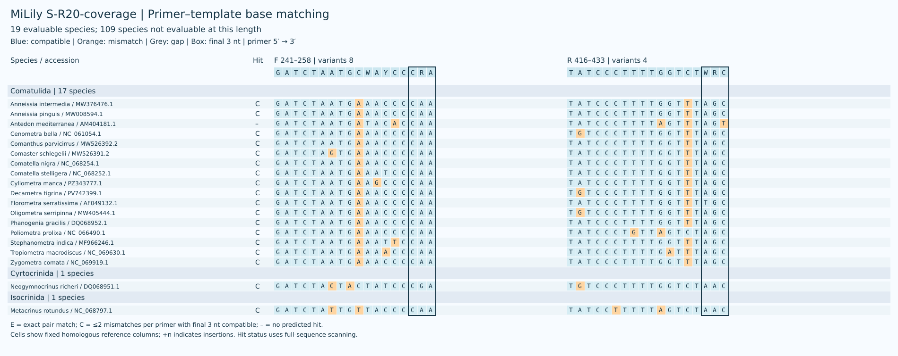
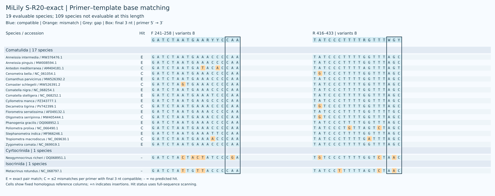
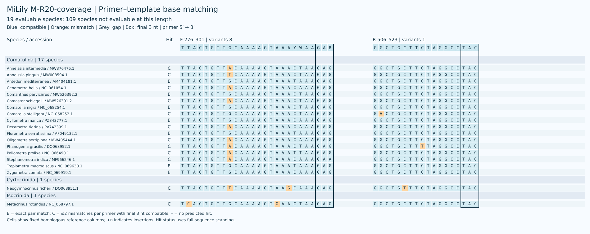
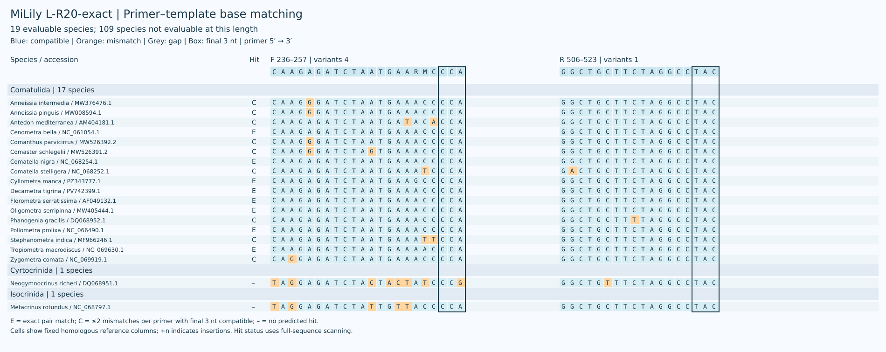
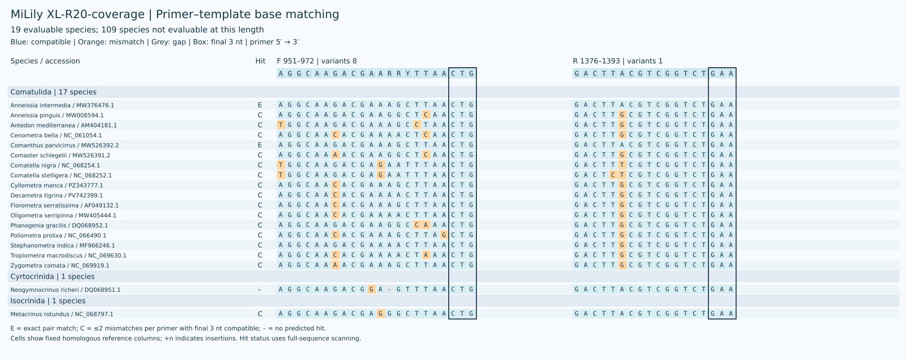

# MiLily

[中文](README.zh-CN.md)

MiLily comprises candidate mitochondrial 16S rRNA primers for crinoid environmental DNA in five windows: XS, S, M, L and XL. All newly screened single-pair candidates are retained; candidates within each window share reference endpoints.
The primary metrics **weight evaluable species equally**, using one representative sequence per species. The reference panel contains 128 named species; reference representation does not measure global order richness.
Only 19 species are evaluable for S–XL; the other 109 lack the required binding windows. XS is unchanged and assessed separately.

[参考面板 / Reference panel](results/species_qc/panel.csv) · [分类与覆盖 / Coverage by order](results/species_refine/by_order.csv) · [参考序列审核 / Reference curation](results/species_qc/README.md)

## Current performance

| Candidate | Species coverage | Exact | Strict WC / GT | WC≤3 / GT≤2 |
|---|---:|---:|---:|---:|
| S-R20-coverage | 18/19 (94.74%) | 0/19 (0.00%) | 0 / 0 | 0 / 0 |
| S-R20-exact | 17/19 (89.47%) | 10/19 (52.63%) | 0 / 5 | 0 / 10 |
| M-R20-coverage | 19/19 (100.00%) | 7/19 (36.84%) | 2 / 9 | 13 / 10 |
| L-R20-coverage | 18/19 (94.74%) | 6/19 (31.58%) | 0 / 0 | 0 / 0 |
| L-R20-exact | 17/19 (89.47%) | 8/19 (42.11%) | 0 / 0 | 0 / 0 |
| XL-R20-coverage | 18/19 (94.74%) | 2/19 (10.53%) | 0 / 3 | 4 / 3 |

Coverage requires at most two mismatches per primer with compatible terminal 3 nt; exact matching requires zero mismatches in both primers. Strict WC/GT count non-target records under the terminal constraint; WC≤3 and GT≤2 are permissive screens without it.

## Selection and tradeoffs

New candidate oligos have at most eight variants, with ambiguity confined to the 3′ half. Coverage-prioritised and exact-match-prioritised candidates are retained separately. These are computational predictions requiring experimental validation.

XS retains its supplied sequence; its structural and background assessment is reported separately in [XS assessment](results/xs/assessment.json).

[筛选结果与复核 / Screening and verification](results/species_refine/README.md) · [引物序列 / Primer sequences](sequences/primer_pairs.csv)

## XS

| Name | F (5′→3′) | R (5′→3′) |
|---|---|---|
| XS | `TTGGGGCAACCDCGAAG` | `CAACATCGAGGTCGCAAAC` |

## S

| Name | F (5′→3′) | R (5′→3′) |
|---|---|---|
| S-R20-coverage | `GATCTAATGCWAYCCCRA` | `TATCCCTTTTGGTCTWRC` |
| S-R20-exact | `GATCTAATGAARYYCCAA` | `TATCCCTTTTRGTTTWGY` |

## M

| Name | F (5′→3′) | R (5′→3′) |
|---|---|---|
| M-R20-coverage | `TTACTGTTGCAAAAGTAAAYWAAGAR` | `GGCTGCTTCTAGGCCTAC` |

## L

| Name | F (5′→3′) | R (5′→3′) |
|---|---|---|
| L-R20-coverage | `CAAGAGATCTAWTGWWACCCCA` | `GGCTGCTTCTAGGCCTAC` |
| L-R20-exact | `CAAGAGATCTAATGAARMCCCA` | `GGCTGCTTCTAGGCCTAC` |

## XL

| Name | F (5′→3′) | R (5′→3′) |
|---|---|---|
| XL-R20-coverage | `AGGCAAGACGAARRYTTAACTG` | `GACTTACGTCGGTCTGAA` |

## Methods and data

[Reference curation](results/species_qc/README.md) · [Screening comparison](results/species_refine/comparison.csv) · [Copyright](COPYRIGHT.md)
