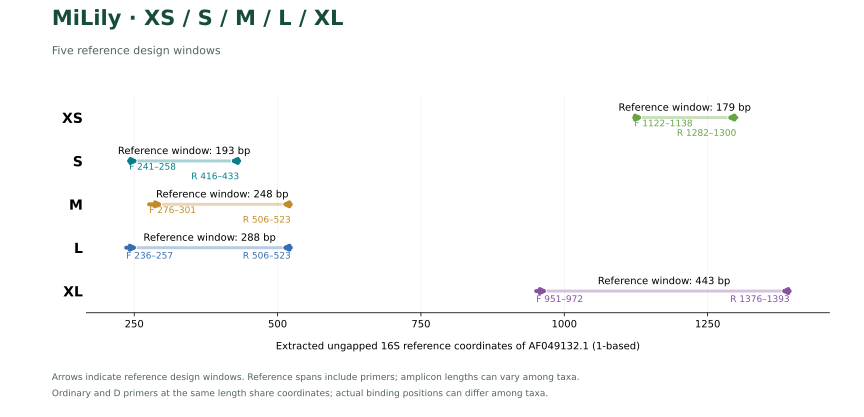
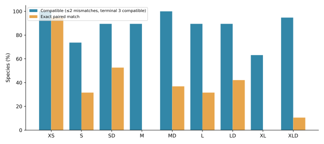
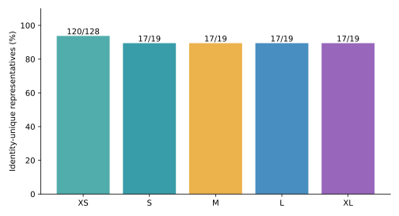
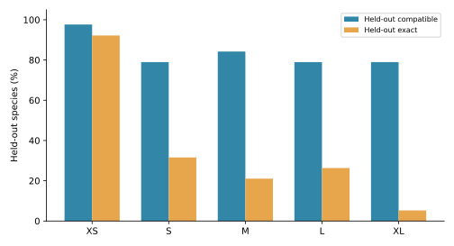

# MiLily

[中文](README.zh-CN.md)

Preprint: [PDF](publications/MiLily_preprint.pdf) · [Markdown](publications/MiLily_preprint.md) · [Provenance](publications/preprint_provenance.json)

## Abstract

Candidate mitochondrial 16S rRNA primers for environmental DNA across XS, S, M, L and XL. Each S–XL window retains an ordinary pair and a degenerate D pair at shared reference coordinates; XS is a single retained pair.
One reference per species is retained. Primary metrics weight evaluable species equally, with order-level results reported separately.
The crinoid panel contains 128 species, but only 19 are evaluable for S–XL. XS was designed manually and is assessed separately.

S–XL were evaluated on 19 species, while the manually designed XS was assessed separately. SD covers 17/19 and MD covers 19/19 on the current S–XL panel. These values describe the frozen S–XL reference panel; the new analyses below compare windows on a common denominator.

The common five-window panel contains 19 species. This release adds equal-denominator comparisons, primer-free barcode identity and nearest-neighbor analysis, and genus-blocked conditional sequence-selection tests. Released primer sequences remain unchanged.

## Introduction

Environmental DNA metabarcoding of crinoids depends on reference sequences that represent both the target taxa and the primer-binding sites. MiLily compares mitochondrial 16S primer windows and includes a manually designed XS pair assessed on its own reference panel. Marine eDNA metabarcoding studies demonstrate the importance of marker and reference-library choice (Gold et al., 2022); MiFish provides an example of sequence-alignment-based primer design for fishes (Miya et al., 2015). Mitochondrial 16S has been used alongside other markers in crinoid phylogenetic studies (Taylor et al., 2023).

[参考面板 / Reference panel](results/species_qc/panel.csv) · [参考序列审核 / Reference curation](results/species_qc/README.md)

## Methods

### Reference datasets and alignment

The target library comprised 269 mitochondrial sequence records from crinoids; the non-target library comprised 7,177 reference records. Target records were reviewed for sequence quality and taxonomy, and one representative was retained per identifiable species (128 species). Representatives were selected using binding-window completeness, ambiguous bases and reference-site coverage, without using primer-match outcomes. The retained sequences were realigned with MAFFT 7.526 (Katoh & Standley, 2013) using the ungapped mitochondrial 16S rRNA reference AF049132.1; positions are reported as 1-based coordinates. For the curated species panels, each binding window had to span the reference region, contain at least 90% of its reference-site count as A/C/G/T, and contain no ambiguous nucleotide; alignment gaps were permitted. The numbers of evaluable species were 19 for each S–XL window; missing windows were excluded from the corresponding denominator. The [reference audit](results/species_qc/README.md) provides the selection criteria and accession-level records.

### Primer design and screening

Ordinary and degenerate candidates were compared within fixed forward and reverse reference windows. For S–XL, the ordinary and D pairs at each length share the same reference endpoints. D oligonucleotides were limited to eight concrete variants per primer, with IUPAC ambiguity confined to the 3′ half. Terminal screening excluded homotriplet ends and homopolymers longer than four bases and required a G or C in the final three positions. Primer3 (Untergasser et al., 2012) evaluations used 50 mM monovalent salt, 1.5 mM Mg²⁺ and 0.6 mM dNTP, under 50 nM per variant and 200 nM total per direction. The S–XL structural gate required a maximum predicted structure Tm below 55 °C and a forward–reverse duplex-Tm midpoint difference of at most 5 °C. XS was designed manually and assessed separately on its original 27-reference, 25-label panel. Its non-target and secondary-structure results were recorded separately rather than applying the S–XL selection gates retrospectively.

### In-silico evaluation

Target coverage required at most two mismatches per primer and IUPAC-compatible final 3 nt; exact matching required zero mismatches at both sites. For S–XL, paired target scans required an amplicon of 150–500 bp and an internal distance of at least 50 bp. Background searches allowed an internal distance of 0–1,000 bp. Strict Watson–Crick (WC) and G–T models retained the terminal constraint; WC≤3 and GT≤2 were additional permissive screens without that constraint. For the current S–XL species panel, coverage and exact-match percentages weighted evaluable species equally, with results also summarized by order; non-target counts represent reference records. C++ and Python scans were compared on the same sequence data to verify target and strict background hit sets. These results describe computational template compatibility.

### Common panel, barcode discrimination and genus-blocked holdout

The accession intersection of all five windows contains 19 species and provides a common denominator for length comparisons. Own-window results are reported separately. Primer-free inserts were extracted strictly between the aligned binding windows, with gaps removed and ambiguous inserts excluded. Identity uniqueness was assessed against every available unambiguous insert for that window, including species outside the common panel. Unit-cost Levenshtein distances identified each species' nearest other-species neighbor. These analyses separate primer compatibility from barcode discrimination (Riaz et al., 2011).

Five-fold genus-blocked selection used seed 20261030. Genera sharing identical complete representative sequences were linked into one block, preventing duplicate-sequence leakage. Each fold selected new F/R sequences using training species only, without released primers or global candidate pools as seeds. A deterministic greedy search used up to 24 admissible frequent concrete seeds per side, 3′-half ambiguity, ≤8 variants per oligonucleotide and fixed oligonucleotide lengths, allowing local offsets within five alignment columns of the previously chosen binding intervals. Held-out species were assessed by raw-sequence paired scans with the existing window-specific size and mismatch rules. Region discovery preceded splitting, and fold candidates were not screened with the formal thermal/background gates; this is conditional sequence-selection testing rather than external validation of the complete design pipeline. Fold sequences are diagnostic candidates, not released replacement primers.

The unchanged manually designed XS was additionally scanned on a newly derived 128-species panel using the released binding-window completeness rule (full span, ≥90% A/C/G/T support and no ambiguous binding bases). An independent naive position-by-position scan checked the resulting paired hits. This is a new curated-species evaluation, separate from its original 27-reference/25-label assessment. The XS-region fold test selects diagnostic sequences only and does not redesign or replace the manual XS.

[Analysis methods and reproduction](results/computational_evaluation/README.md)

[Detailed methods](docs/METHODS.md) · [Validation](docs/VALIDATION.md)

## Results

### Predicted performance

| Name | Coverage | Exact | Strict WC / GT | WC≤3 / GT≤2 |
|---|---:|---:|---:|---:|
| S | 14/19 (73.68%) | 6/19 (31.58%) | 0 / 0 | 0 / 0 |
| SD | 17/19 (89.47%) | 10/19 (52.63%) | 0 / 5 | 0 / 10 |
| M | 17/19 (89.47%) | 0/19 (0.00%) | 0 / 1 | 4 / 1 |
| MD | 19/19 (100.00%) | 7/19 (36.84%) | 2 / 9 | 13 / 10 |
| L | 17/19 (89.47%) | 6/19 (31.58%) | 0 / 0 | 0 / 0 |
| LD | 17/19 (89.47%) | 8/19 (42.11%) | 0 / 0 | 0 / 0 |
| XL | 12/19 (63.16%) | 0/19 (0.00%) | 0 / 0 | 0 / 0 |
| XLD | 18/19 (94.74%) | 2/19 (10.53%) | 0 / 3 | 4 / 3 |

Coverage allows at most two mismatches per primer with compatible terminal 3 nt; exact matching requires zero mismatches in both primers. Strict WC/GT retain the terminal constraint; WC≤3 / GT≤2 are permissive background screens.

Each D primer has at most eight variants, with ambiguity confined to its 3′ half. XS is a single pair with a fixed name. Results describe computational compatibility.

SD covers all 17 evaluable Comatulida but neither the Cyrtocrinida nor Isocrinida representative. The XS structure and background assessment is reported in [XS assessment](results/xs/assessment.json).

### Common-panel comparison

| Name | Coverage | Exact | Covered + identity-unique |
| --- | --- | --- | --- |
| XS | 19/19 | 18/19 | 16/19 |
| S | 14/19 | 6/19 | 12/19 |
| SD | 17/19 | 10/19 | 15/19 |
| M | 17/19 | 0/19 | 15/19 |
| MD | 19/19 | 7/19 | 17/19 |
| L | 17/19 | 6/19 | 15/19 |
| LD | 17/19 | 8/19 | 15/19 |
| XL | 12/19 | 0/19 | 10/19 |
| XLD | 18/19 | 2/19 | 16/19 |

All assay denominators in this table are 19. The last column counts species both covered by the primers and carrying an insert not shared by any other available species in the same window. Unavailable windows are excluded rather than counted as failures.

### Primer-free barcode discrimination

| Window | Unambiguous inserts | Identity-unique species | Insert length (bp) |
| --- | --- | --- | --- |
| XS | 128 | 120/128 | 123–158 |
| S | 19 | 17/19 | 157–164 |
| M | 19 | 17/19 | 201–212 |
| L | 19 | 17/19 | 248–257 |
| XL | 19 | 17/19 | 403–431 |

Insert lengths exclude both primers. Identity uniqueness describes one representative per species and does not establish population-wide resolution or identification accuracy. Cross-species identical inserts are reported as reference conflicts requiring source and taxonomic review. Common-panel uniqueness is assessed against the full available barcode set, so a sequence unique within the common subset can still have a competitor outside it.

[Identical-barcode conflicts](results/computational_evaluation/results/barcode_collisions.csv) · [Nearest-neighbor edit distances](results/computational_evaluation/results/nearest_neighbors.csv) · [Conflict-exclusion sensitivity](results/computational_evaluation/results/conflict_exclusion_sensitivity.csv)

### Genus-blocked conditional holdout

| Window | Held-out coverage | Held-out exact |
| --- | --- | --- |
| XS | 125/128 (97.66%) | 118/128 (92.19%) |
| S | 15/19 (78.95%) | 6/19 (31.58%) |
| M | 16/19 (84.21%) | 4/19 (21.05%) |
| L | 15/19 (78.95%) | 5/19 (26.32%) |
| XL | 15/19 (78.95%) | 1/19 (5.26%) |

These are pooled predictions from 25 fold-specific training-selected pairs, not performance estimates for the released ordinary/D primers. Each species is tested once within its window. Thermal and background gates were not applied to fold candidates, so compatibility scores alone cannot justify replacing released assays. Fold sizes and per-species predictions are supplied to expose unequal genus sampling.

[Fold candidates](results/computational_evaluation/results/cv_folds.csv) · [Held-out predictions](results/computational_evaluation/results/cv_predictions.csv) · [Own/common-panel tables](results/computational_evaluation/results/panel_comparison.csv)

### Unchanged manual XS on the curated species panel

The manual XS covers 127/128 species (99.22%) with 114/128 exact paired matches (89.06%). On the common 19 species it covers 19/19, with 18/19 exact matches. Among the 128 unambiguous inserts, 120 are identity-unique; 119/128 species are both covered and identity-unique. These target-only results do not alter the original XS thermal/background assessment or imply that it passes S–XL selection gates. The sequence and original-panel base diagram are retained.

### XS

| Name | F (5′→3′) | R (5′→3′) |
|---|---|---|
| XS | `TTGGGGCAACCDCGAAG` | `CAACATCGAGGTCGCAAAC` |

The XS diagram uses its original reference panel.

### S

| Name | F (5′→3′) | R (5′→3′) |
|---|---|---|
| S | `GATCTAATGAAACCCCAA` | `TATCCCTTTTGGTTTAGC` |
| SD | `GATCTAATGAARYYCCAA` | `TATCCCTTTTRGTTTWGY` |

[S · Orders](results/current_primers/S/S_by_order.csv) · [Species](results/current_primers/S/S_by_taxon.csv)

[SD · Orders](results/current_primers/S/SD_by_order.csv) · [Species](results/current_primers/S/SD_by_taxon.csv)

### M

| Name | F (5′→3′) | R (5′→3′) |
|---|---|---|
| M | `TTACTGTTGCAAAAGTAAACTAAGAG` | `GGCTGTTTCTAGGCCTAC` |
| MD | `TTACTGTTGCAAAAGTAAAYWAAGAR` | `GGCTGCTTCTAGGCCTAC` |

[M · Orders](results/current_primers/M/M_by_order.csv) · [Species](results/current_primers/M/M_by_taxon.csv)

[MD · Orders](results/current_primers/M/MD_by_order.csv) · [Species](results/current_primers/M/MD_by_taxon.csv)

### L

| Name | F (5′→3′) | R (5′→3′) |
|---|---|---|
| L | `CAAGAGATCTAATGAAACCCCA` | `GGCTGCTTCTAGGCCTAC` |
| LD | `CAAGAGATCTAATGAARMCCCA` | `GGCTGCTTCTAGGCCTAC` |

[L · Orders](results/current_primers/L/L_by_order.csv) · [Species](results/current_primers/L/L_by_taxon.csv)

[LD · Orders](results/current_primers/L/LD_by_order.csv) · [Species](results/current_primers/L/LD_by_taxon.csv)

### XL

| Name | F (5′→3′) | R (5′→3′) |
|---|---|---|
| XL | `AGGCAAGACGAAAGCTTAACTG` | `GACTTGCGTCGGTCTGAA` |
| XLD | `AGGCAAGACGAARRYTTAACTG` | `GACTTACGTCGGTCTGAA` |

[XL · Orders](results/current_primers/XL/XL_by_order.csv) · [Species](results/current_primers/XL/XL_by_taxon.csv)

[XLD · Orders](results/current_primers/XL/XLD_by_order.csv) · [Species](results/current_primers/XL/XLD_by_taxon.csv)

## Discussion

The S–XL evaluation includes 19 species from the curated 128-species panel. SD covers all 17 evaluable Comatulida but not the sampled Cyrtocrinida or Isocrinida representatives. The manually designed XS was evaluated on a different 27-reference, 25-label panel and has predicted secondary-structure and non-target matches; its metrics should therefore be interpreted using that panel and assessment. Broader reference sampling and laboratory validation are needed to assess performance across crinoids.

[Copyright / 著作权](COPYRIGHT.md)

## Citation

If you use the primers, reference data or analysis code, please cite:

Xia, F. (2026). *MiLily: candidate mitochondrial 16S rRNA primers for crinoid environmental DNA metabarcoding*. GitHub. https://github.com/GUIBA-EX/MiLily

[CITATION.cff](CITATION.cff) · [BibTeX](CITATION.bib)

## References

1. Gold, Z., Wall, A. R., Schweizer, T. M., et al. (2022). A manager’s guide to using eDNA metabarcoding in marine ecosystems. *PeerJ*, 10, e14071. https://doi.org/10.7717/peerj.14071

2. Miya, M., Sato, Y., Fukunaga, T., et al. (2015). MiFish, a set of universal PCR primers for metabarcoding environmental DNA from fishes: detection of more than 230 subtropical marine species. *Royal Society Open Science*, 2, 150088. https://doi.org/10.1098/rsos.150088

3. Taylor, K. H., Rouse, G. W., & Messing, C. G. (2023). Phylogeny and taxonomy of Himerometroidea (Echinodermata: Crinoidea). *Zootaxa*, 5277, 149–164. https://doi.org/10.11646/zootaxa.5277.1.7

4. Katoh, K., & Standley, D. M. (2013). MAFFT multiple sequence alignment software version 7: improvements in performance and usability. *Molecular Biology and Evolution*, 30, 772–780. https://doi.org/10.1093/molbev/mst010

5. Untergasser, A., Cutcutache, I., Koressaar, T., et al. (2012). Primer3—new capabilities and interfaces. *Nucleic Acids Research*, 40, e115. https://doi.org/10.1093/nar/gks596

6. Riaz, T., Shehzad, W., Viari, A., et al. (2011). ecoPrimers: inference of new DNA barcode markers from whole genome sequence analysis. *Nucleic Acids Research*, 39, e145. https://doi.org/10.1093/nar/gkr732
