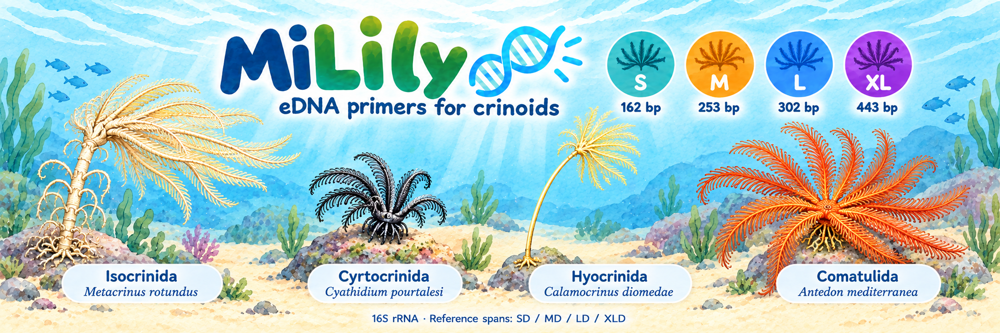
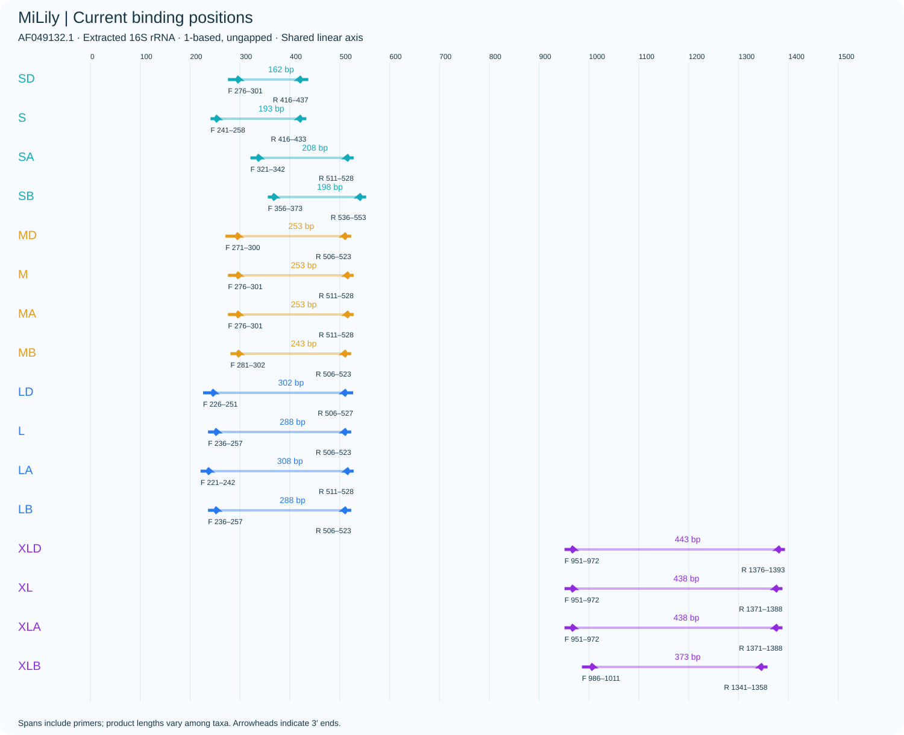
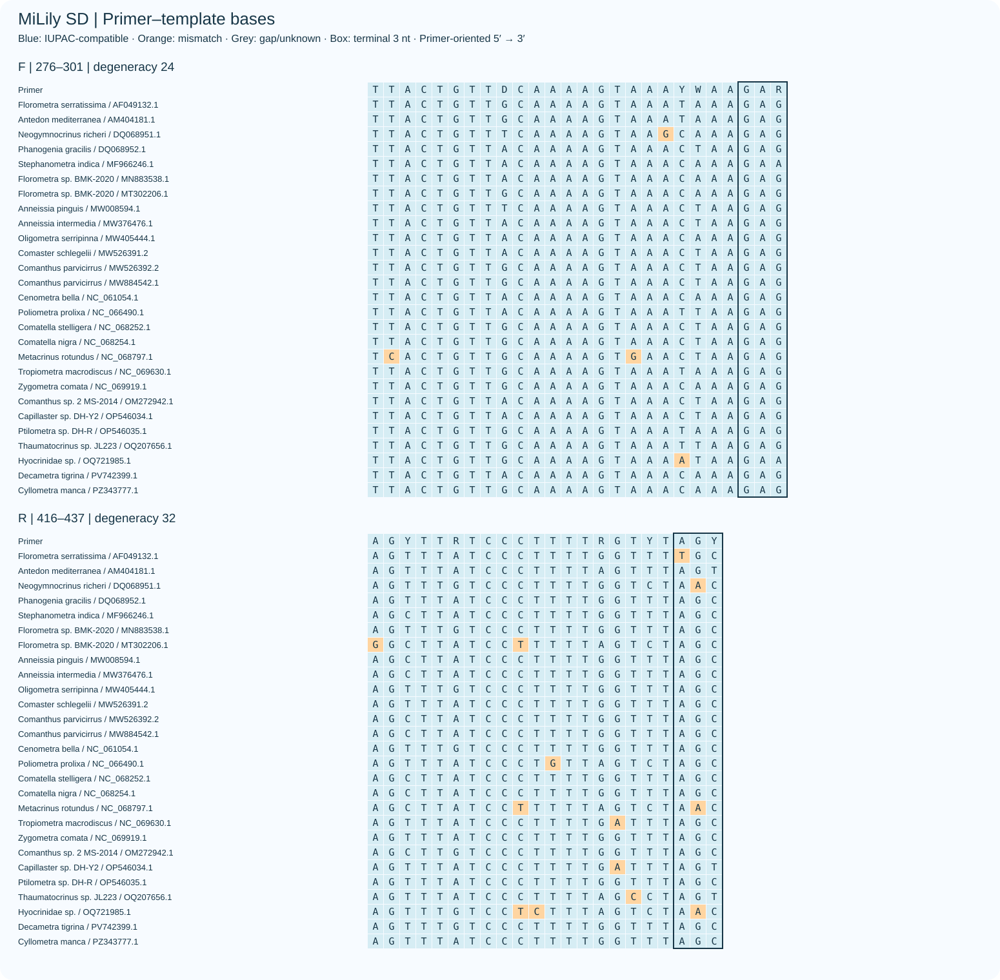
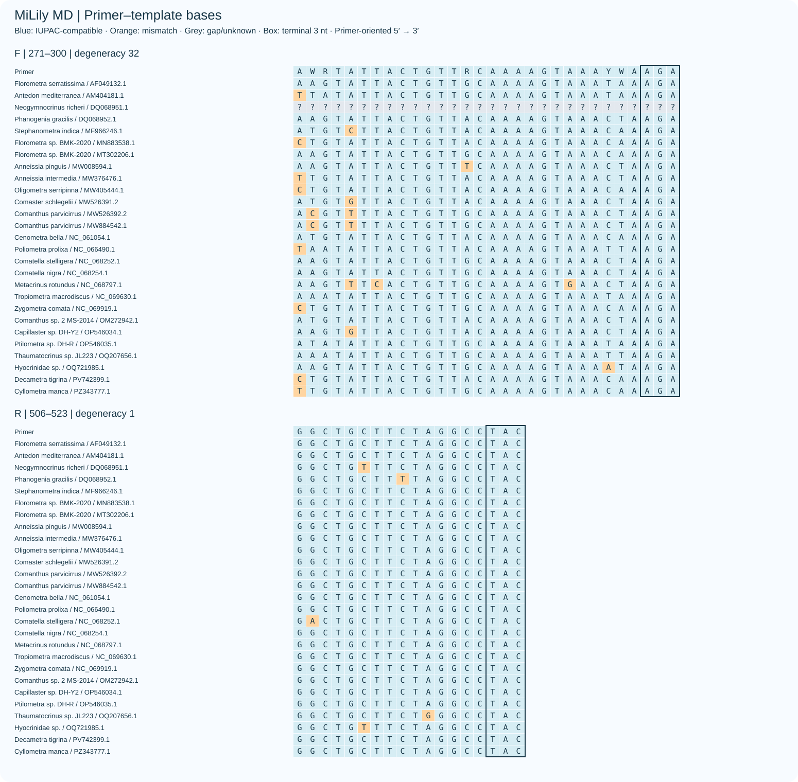
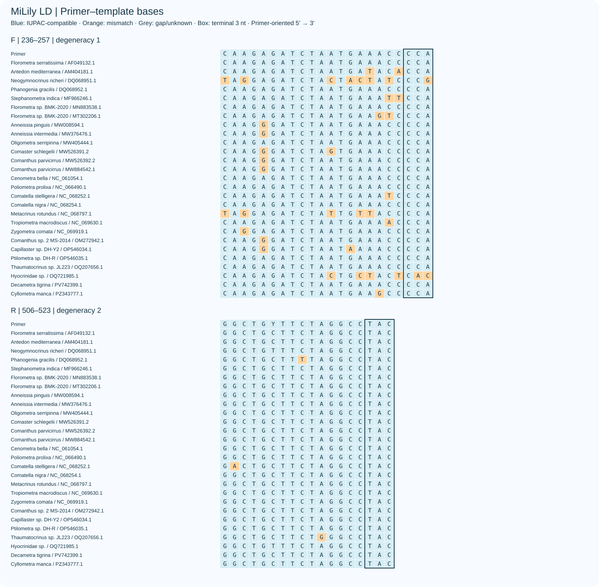
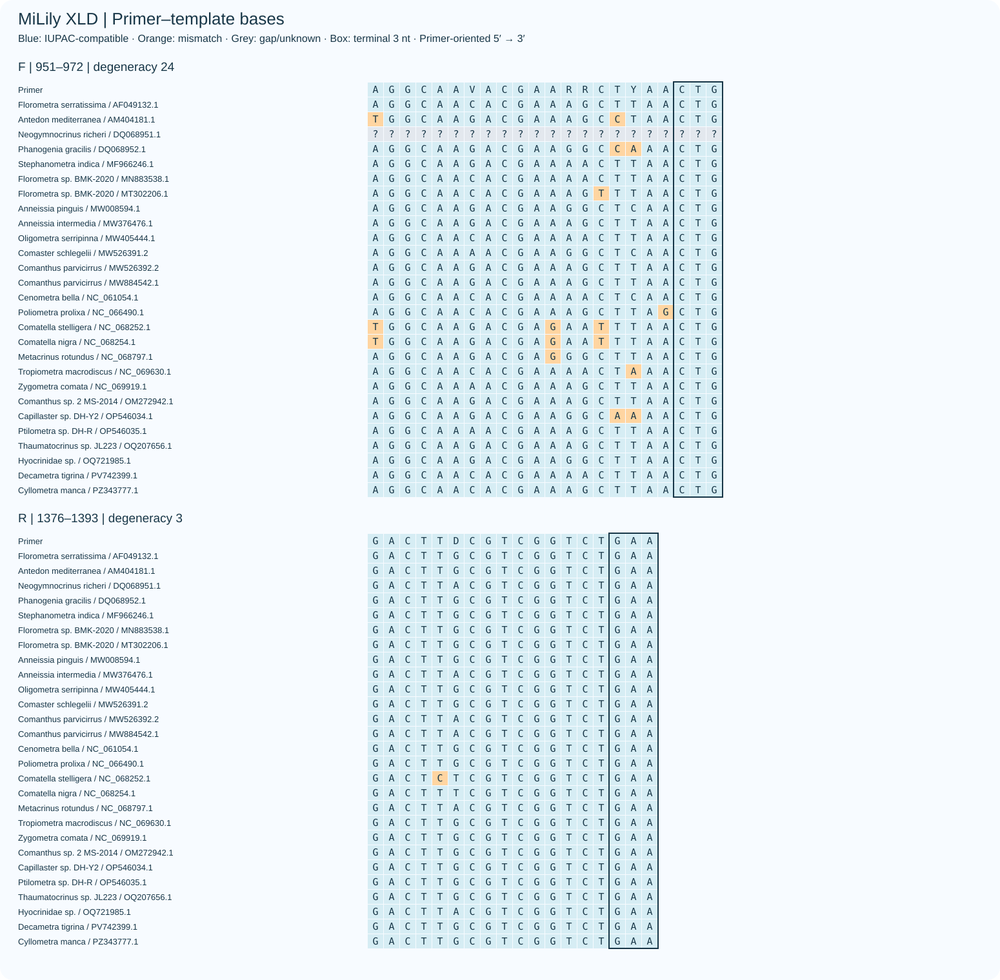

# MiLily

海百合纲线粒体16S引物 · 首轮计算设计

[English](README.md)

介绍图徽标为SD、MD、LD、XLD在参考序列上的跨度（含引物）：162、253、302、443 bp。下图显示全部候选的真实结合坐标；插画参考用户提供的真实物种图版，分别展示Isocrinida（Metacrinus rotundus）、Cyrtocrinida（Cyathidium pourtalesi）、Hyocrinida（Calamocrinus diomedae）和Comatulida（Antedon mediterranea）的代表。图示为形态比较，不表示四个代表种均已验证扩增。[图版参考与署名](figures/overview_design.md)。

沿用MiCucumber／MiUrchin方法，比较S、M、L、XL四档长度的普通与简并方案。D为简并单对；无后缀为普通单对，A/B为两次独立PCR的普通引物组件。共12套方案、16对记录、32条寡核苷酸。A/B是同一对结合区域的碱基序列变体：F与R的起止坐标分别完全相同，只允许碱基替换；不靠移动位点获得互补覆盖。不同长度或不同备选方案仍可能选择不同区域。

## 首轮选择

优先比较 **SD（短片段、较高完全匹配）**、**MD（最高简并单对覆盖）**、**LD（中等长度兼顾覆盖与完全匹配）**。若优先减少寡核苷酸种类，普通 **L单对**可作为重点候选：覆盖率88%、完全匹配率30%，WC≤3、GT≤2及WC≤4背景命中均为0。同位点LA/LB将完全匹配率提升到46%，未增加覆盖。XLD完全匹配率62%，但WC≤4背景命中104条，须单独评估。以上均为计算筛选结果，尚未做PCR实测。

## 共同完整序列面板

27个标签内去重的完整序列、25个分类名称标签（包含未定种，不等于25个已确认物种）。标签等权，标签内单倍型等权。覆盖要求每条引物≤2个错配且末端3位IUPAC相容；完全匹配要求两条引物均零错配。

| 方案 | 覆盖率 | 完全匹配率 | WC≤3 | GT≤2 | WC≤4 | 观测产物 bp |
|---|---:|---:|---:|---:|---:|---|
| SD | 84.0% | 66.0% | 0 | 0 | 11 | 160–170 |
| S | 66.0% | 28.0% | 0 | 0 | 0 | 194–203 |
| SA+SB | 66.0% | 46.0% | 0 | 0 | 0 | 194–203 |
| MD | 92.0% | 26.0% | 0 | 0 | 2 | 250–260 |
| M | 76.0% | 14.0% | 4 | 2 | 11 | 250–260 |
| MA+MB | 88.0% | 16.0% | 4 | 1 | 14 | 245–255 |
| LD | 88.0% | 54.0% | 0 | 1 | 9 | 302–311 |
| L | 88.0% | 30.0% | 0 | 0 | 0 | 288–297 |
| LA+LB | 88.0% | 46.0% | 0 | 0 | 0 | 288–297 |
| XLD | 88.0% | 62.0% | 3 | 0 | 104 | 443–471 |
| XL | 68.0% | 8.0% | 0 | 0 | 26 | 438–462 |
| XLA+XLB | 80.0% | 22.0% | 5 | 0 | 141 | 432–465 |

背景为7,177条冻结记录；背景数字是命中的accession数，不是扩增概率。GT模型允许可能的G–T配对；WC≤4为更宽松的敏感性分析。两对结果为独立PCR并集，未验证混合多重PCR。

## 参考数据与局限

使用已有MiStar／MiCucumber冻结数据库的269条海百合纲16S记录，未进行本轮全面更新。参考坐标为*Florometra serratissima* AF049132.1提取的16S，1-based、无gap。S/M/L/XL参考跨度分别为150–224、225–284、285–359、360–450 bp，包含引物；实际类群长度可以超出分档。

多数短片段不跨越候选位点：除XLA/XLB外，各方案为43条记录、25个标签可评估，包含完整序列的重复记录，去重后的加权结果与完整面板相同。XLA/XLB可评估93条记录、64个标签，覆盖率82.03%、完全匹配率8.59%；可评估集合不同，不用于跨方案直接排名。位点未覆盖标为不可评估，不直接计为漏检。设计面板同时用于选择和评价，结果不是独立留出测试；本轮搜索为有限位置与长度网格及空间分箱候选集，不保证全局最优。

## 末端与热力学

允许3′端简并，包括最后一位。逐一检查所有实际变体：无末端三连同碱基，末端3位至少1个G/C、末端5位1–4个G/C，全序列连续同碱基不超过4。使用50 nM/变体和200 nM/方向平均分配两种浓度；50 mM单价盐、1.5 mM Mg、0.6 mM dNTP。两种情景的所有发卡和二聚体Tm均低于55°C，F/R Tm区间中点差≤5°C；不等浓度异二聚体按较高一方浓度近似。

## 序列、图件与复现

[Paired sequences](sequences/primer_pairs.csv) · [FASTA](sequences/primers.fasta) · [Full comparison](results/comparison.csv) · [Missed panel references](results/missed_references.csv) · [Target evaluation](results/target_evaluation.csv) · [Background accessions](results/background_hits.csv) · [Observed barcode resolution](results/barcode_resolution.csv)

[All base-matching figures](results/base_matching.html) · [Coordinates](results/binding_positions.csv) · [Terminal audit](results/terminal_audit.csv) · [Thermodynamics](results/thermal.csv) · [Independent verification](results/verification.json) · [方法](docs/METHODS.zh-CN.md) · [复现](docs/REPRODUCIBILITY.md)

碱基匹配图按引物5′→3′方向显示全部27个完整序列；蓝色为IUPAC相容，橙色为错配，框选末端3位。问号表示长度不一致窗口。条形码分辨率仅描述当前被检出标签之间是否共享完全相同的内部序列，不代表真实物种鉴定准确率。

### S

序列均按5′→3′书写；R为直接订购的反向引物序列。

| 名称 | 正向引物 F | 反向引物 R | 简并度 F / R |
|---|---|---|---:|
| SD | `TTACTGTTDCAAAAGTAAAYWAAGAR` | `AGYTTRTCCCTTTTRGTYTAGY` | 24 / 32 |
| S | `GATCTAATGAAACCCCAA` | `TATCCCTTTTGGTTTAGC` | 1 / 1 |
| SA | `GATCTAATGAAACCCCAA` | `TATCCCTTTTGGTTTAGC` | 1 / 1 |
| SB | `GATCTAATGAAACCCCAA` | `TGTCCCTTTTGGTTTAGC` | 1 / 1 |

[Ordinary S](figures/base_matching_S.svg) · [SA](figures/base_matching_SA.svg) · [SB](figures/base_matching_SB.svg)

### M

序列均按5′→3′书写；R为直接订购的反向引物序列。

| 名称 | 正向引物 F | 反向引物 R | 简并度 F / R |
|---|---|---|---:|
| MD | `AWRTATTACTGTTRCAAAAGTAAAYWAAGA` | `GGCTGCTTCTAGGCCTAC` | 32 / 1 |
| M | `TTACTGTTACAAAAGTAAACAAAGAG` | `TTGGTGGCTGCTTCTAGG` | 1 / 1 |
| MA | `TTACTGTTGCAAAAGTAAACTAAGAG` | `GGCTGTTTCTAGGCCTAC` | 1 / 1 |
| MB | `TTACTGTTACAAAAGTAAACTAAGAG` | `GGCTGCTTCTAGGCCTAC` | 1 / 1 |

[Ordinary M](figures/base_matching_M.svg) · [MA](figures/base_matching_MA.svg) · [MB](figures/base_matching_MB.svg)

### L

序列均按5′→3′书写；R为直接订购的反向引物序列。

| 名称 | 正向引物 F | 反向引物 R | 简并度 F / R |
|---|---|---|---:|
| LD | `WACCCGAAACCARGRGATCTAATGMW` | `WGDTGGCTGYTTCTAGGCCTAC` | 32 / 12 |
| L | `CAAGAGATCTAATGAAACCCCA` | `GGCTGCTTCTAGGCCTAC` | 1 / 1 |
| LA | `CAAGAGATCTAATGAAACCCCA` | `GGCTGCTTCTAGGCCTAC` | 1 / 1 |
| LB | `CAAGGGATCTAATGAAACCCCA` | `GGCTGCTTCTAGGCCTAC` | 1 / 1 |

[Ordinary L](figures/base_matching_L.svg) · [LA](figures/base_matching_LA.svg) · [LB](figures/base_matching_LB.svg)

### XL

序列均按5′→3′书写；R为直接订购的反向引物序列。

| 名称 | 正向引物 F | 反向引物 R | 简并度 F / R |
|---|---|---|---:|
| XLD | `AGGCAAVACGAARRCTYAACTG` | `GACTTDCGTCGGTCTGAA` | 24 / 3 |
| XL | `AGGCAAGACGAAAGCTTAACTG` | `GCGTCGGTCTGAACTCAG` | 1 / 1 |
| XLA | `TAATTGAGGACTAGAATGAAAGGCAA` | `GGGCTTTAAAGGTCGAACAGAC` | 1 / 1 |
| XLB | `TAATTGAGGACTAGAATGAAAGGCAA` | `AGGCTTTAAAGGTCGAACAGAC` | 1 / 1 |

[Ordinary XL](figures/base_matching_XL.svg) · [XLA](figures/base_matching_XLA.svg) · [XLB](figures/base_matching_XLB.svg)

独立全序列扫描复核：864项目标状态、32项背景集合比较均无差异。详见复核记录。

[Copyright / 著作权声明](COPYRIGHT.md)

[GitHub: GUIBA-EX/MiLily](https://github.com/GUIBA-EX/MiLily) · [文件索引 / File index](docs/FILES.md)

[同位点审计 / Same-locus audit](results/same_locus_audit.csv) · [A/B修正前后比较 / Before–after comparison](results/same_locus_comparison.csv)
