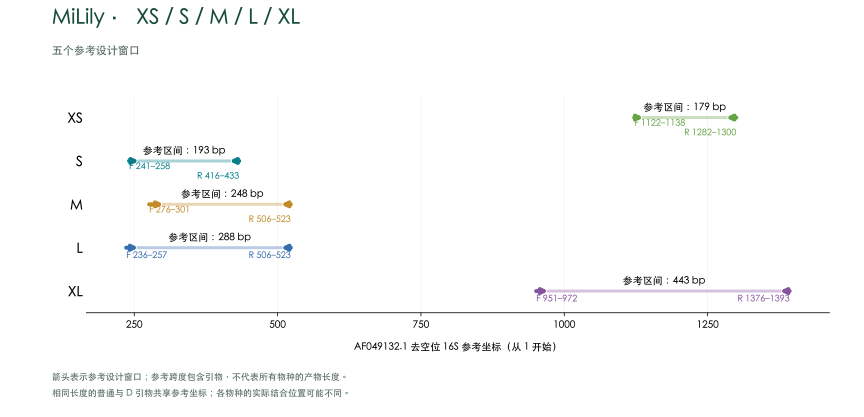

# MiLily

[English](README.md)

## 摘要

线粒体 16S rRNA 环境 DNA 候选引物，包含 XS、S、M、L、XL。S–XL 各保留普通单对及简并单对 D，同长度共享参考坐标；XS 为固定单对。
每个物种保留一条参考序列；主指标对可评价物种等权，各目单列。
海百合参考面板为 128 个物种，但 S–XL 只有 19 个物种可评价；XS 为手动设计并独立评价。

S–XL 在 19 个物种上评价，手动设计的 XS 单独评价。当前 S–XL 面板中 SD 覆盖 17/19，MD 覆盖 19/19；仍需补充参考序列并进行实验验证。

## 引言

海百合环境 DNA 宏条形码分析需要参考序列同时覆盖目标类群和引物结合位点。MiLily 比较不同线粒体 16S 引物窗口，并纳入一对手动设计、使用独立参考面板评价的 XS 引物。 海洋环境 DNA 宏条形码研究显示，标记和参考数据库的选择会影响检测结果（Gold 等，2022）；MiFish 则提供了基于序列比对设计鱼类引物的实例（Miya 等，2015）。线粒体 16S 曾与其他分子标记共同用于海百合系统发育研究（Taylor 等，2023）。

[参考面板 / Reference panel](results/species_qc/panel.csv) · [参考序列审核 / Reference curation](results/species_qc/README.md)

## 方法

### 参考数据与序列比对

目标数据库包含 269 条海百合线粒体序列，非目标数据库包含 7,177 条参考记录。经序列质量和分类审核，每个可确认物种保留一条代表，共 128 个物种。代表序列依据结合窗口完整性、模糊碱基和参考位点覆盖情况选择，不以引物匹配结果为筛选依据。保留序列使用 MAFFT 7.526（Katoh & Standley，2013）重新比对，参考坐标采用去除空位的线粒体 16S rRNA 序列 AF049132.1，从 1 开始计数。清理后的物种面板中，正、反向窗口均需跨越参考区域，A/C/G/T 数量达到参考位点数的 90% 且无模糊碱基，允许比对空位；符合条件的物种才纳入该窗口的评价分母。可评价物种数为 S–XL 各为 19 个。缺失窗口不计为漏检，筛选标准及 accession 记录见[参考序列审核](results/species_qc/README.md)。

### 引物设计与筛选

在固定的正、反向参考窗口内比较普通和简并候选。S–XL 每个长度的普通引物与 D 引物使用相同参考起止坐标。每条 D 引物最多包含 8 种具体序列，IUPAC 简并碱基限于 3′ 半段。末端筛查排除末端三连和超过 4 bp 的同聚物，要求末端 3 nt 至少含一个 G 或 C。Primer3（Untergasser 等，2012）计算采用单价盐 50 mM、Mg²⁺ 1.5 mM、dNTP 0.6 mM，分别评估每变体 50 nM 和每方向总浓度 200 nM 两种情景。S–XL 的结构筛查要求预测结构最高 Tm 低于 55 °C，正、反向双链 Tm 区间中点之差不超过 5 °C。XS 为手动设计的引物，使用原有的 27 条参考序列、25 个分类标签面板单独评价；其非目标和二级结构结果单独记录，不事后套用 S–XL 候选的筛选门槛。

### 计算评价

预测覆盖要求每条引物最多 2 个错配，且末端 3 nt 与模板按 IUPAC 规则兼容；完全匹配要求两个结合位点均无错配。S–XL 目标双引物扫描要求产物长 150–500 bp、双引物之间的内部长度至少 50 bp；非目标扫描允许内部距离 0–1,000 bp。严格 Watson–Crick（WC）和 G–T 模型保留末端约束；WC≤3 和 GT≤2 为不施加末端约束的宽松筛查。当前 S–XL 物种面板的覆盖率和完全匹配率对可评价物种等权，并分别汇总各目结果；非目标数字为参考记录数。使用 C++ 与 Python 对同一参考数据的目标及严格非目标命中集合进行独立算法复核。结果为计算预测，仍需实验验证。

[详细方法](docs/METHODS.zh-CN.md) · [验证](docs/VALIDATION.md)

## 结果

### 预测表现

| Name | Coverage | Exact | Strict WC / GT | WC≤3 / GT≤2 |
|---|---:|---:|---:|---:|
| S | 14/19 (73.68%) | 6/19 (31.58%) | 0 / 0 | 0 / 0 |
| SD | 17/19 (89.47%) | 10/19 (52.63%) | 0 / 5 | 0 / 10 |
| M | 17/19 (89.47%) | 0/19 (0.00%) | 0 / 1 | 4 / 1 |
| MD | 19/19 (100.00%) | 7/19 (36.84%) | 2 / 9 | 13 / 10 |
| L | 17/19 (89.47%) | 6/19 (31.58%) | 0 / 0 | 0 / 0 |
| LD | 17/19 (89.47%) | 8/19 (42.11%) | 0 / 0 | 0 / 0 |
| XL | 12/19 (63.16%) | 0/19 (0.00%) | 0 / 0 | 0 / 0 |
| XLD | 18/19 (94.74%) | 2/19 (10.53%) | 0 / 3 | 4 / 3 |

覆盖要求每条引物最多 2 个错配且末端 3 nt 兼容；完全匹配要求两条引物均无错配。严格 WC/GT 含末端约束；WC≤3 / GT≤2 为宽松非目标筛查。

D 引物每条最多 8 个具体变体，简并位点限于 3′ 半段。XS 是固定命名的特殊单对。计算预测仍需实验验证。

SD 在当前 19 个可评价物种中覆盖全部 17 个 Comatulida，但未覆盖 Cyrtocrinida 和 Isocrinida 的代表。XS 的结构与非目标评估见 [XS 评估](results/xs/assessment.json)。

### XS

| Name | F (5′→3′) | R (5′→3′) |
|---|---|---|
| XS | `TTGGGGCAACCDCGAAG` | `CAACATCGAGGTCGCAAAC` |

XS 图沿用其原参考面板。

### S

| Name | F (5′→3′) | R (5′→3′) |
|---|---|---|
| S | `GATCTAATGAAACCCCAA` | `TATCCCTTTTGGTTTAGC` |
| SD | `GATCTAATGAARYYCCAA` | `TATCCCTTTTRGTTTWGY` |

[S · 各目](results/current_primers/S/S_by_order.csv) · [各物种](results/current_primers/S/S_by_taxon.csv)

[SD · 各目](results/current_primers/S/SD_by_order.csv) · [各物种](results/current_primers/S/SD_by_taxon.csv)

### M

| Name | F (5′→3′) | R (5′→3′) |
|---|---|---|
| M | `TTACTGTTGCAAAAGTAAACTAAGAG` | `GGCTGTTTCTAGGCCTAC` |
| MD | `TTACTGTTGCAAAAGTAAAYWAAGAR` | `GGCTGCTTCTAGGCCTAC` |

[M · 各目](results/current_primers/M/M_by_order.csv) · [各物种](results/current_primers/M/M_by_taxon.csv)

[MD · 各目](results/current_primers/M/MD_by_order.csv) · [各物种](results/current_primers/M/MD_by_taxon.csv)

### L

| Name | F (5′→3′) | R (5′→3′) |
|---|---|---|
| L | `CAAGAGATCTAATGAAACCCCA` | `GGCTGCTTCTAGGCCTAC` |
| LD | `CAAGAGATCTAATGAARMCCCA` | `GGCTGCTTCTAGGCCTAC` |

[L · 各目](results/current_primers/L/L_by_order.csv) · [各物种](results/current_primers/L/L_by_taxon.csv)

[LD · 各目](results/current_primers/L/LD_by_order.csv) · [各物种](results/current_primers/L/LD_by_taxon.csv)

### XL

| Name | F (5′→3′) | R (5′→3′) |
|---|---|---|
| XL | `AGGCAAGACGAAAGCTTAACTG` | `GACTTGCGTCGGTCTGAA` |
| XLD | `AGGCAAGACGAARRYTTAACTG` | `GACTTACGTCGGTCTGAA` |

[XL · 各目](results/current_primers/XL/XL_by_order.csv) · [各物种](results/current_primers/XL/XL_by_taxon.csv)

[XLD · 各目](results/current_primers/XL/XLD_by_order.csv) · [各物种](results/current_primers/XL/XLD_by_taxon.csv)

## 讨论

在清理后的 128 物种面板中，S–XL 的评价覆盖 19 个物种。SD 覆盖全部 17 个可评价的 Comatulida，但未覆盖所采样的 Cyrtocrinida 和 Isocrinida 代表。手动设计的 XS 使用另一套 27 条参考、25 个分类标签的面板评价，并存在预测二级结构和非目标匹配，因此应结合其面板与专门评估解释结果。进一步补充参考序列并进行实验验证，可更好地评价其在海百合中的表现。

[Copyright / 著作权](COPYRIGHT.md)

## 参考文献

1. Gold, Z., Wall, A. R., Schweizer, T. M., et al. (2022). A manager’s guide to using eDNA metabarcoding in marine ecosystems. *PeerJ*, 10, e14071. https://doi.org/10.7717/peerj.14071

2. Miya, M., Sato, Y., Fukunaga, T., et al. (2015). MiFish, a set of universal PCR primers for metabarcoding environmental DNA from fishes: detection of more than 230 subtropical marine species. *Royal Society Open Science*, 2, 150088. https://doi.org/10.1098/rsos.150088

3. Taylor, K. H., Rouse, G. W., & Messing, C. G. (2023). Phylogeny and taxonomy of Himerometroidea (Echinodermata: Crinoidea). *Zootaxa*, 5277, 149–164. https://doi.org/10.11646/zootaxa.5277.1.7

4. Katoh, K., & Standley, D. M. (2013). MAFFT multiple sequence alignment software version 7: improvements in performance and usability. *Molecular Biology and Evolution*, 30, 772–780. https://doi.org/10.1093/molbev/mst010

5. Untergasser, A., Cutcutache, I., Koressaar, T., et al. (2012). Primer3—new capabilities and interfaces. *Nucleic Acids Research*, 40, e115. https://doi.org/10.1093/nar/gks596
