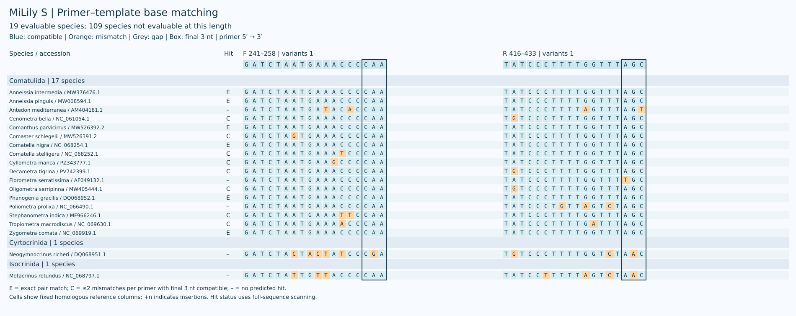
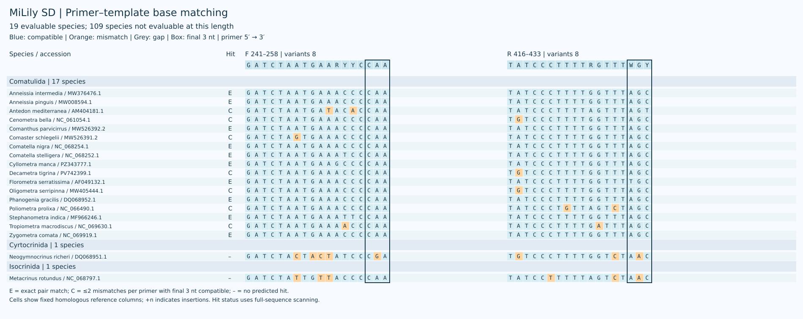
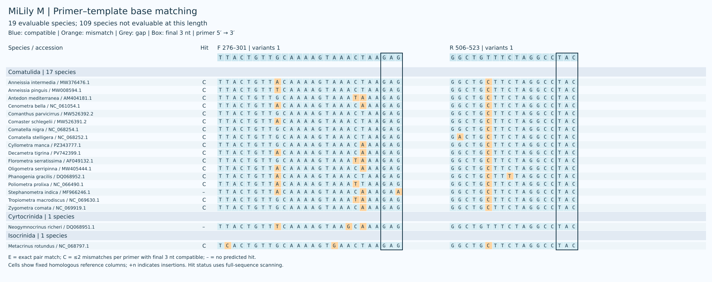
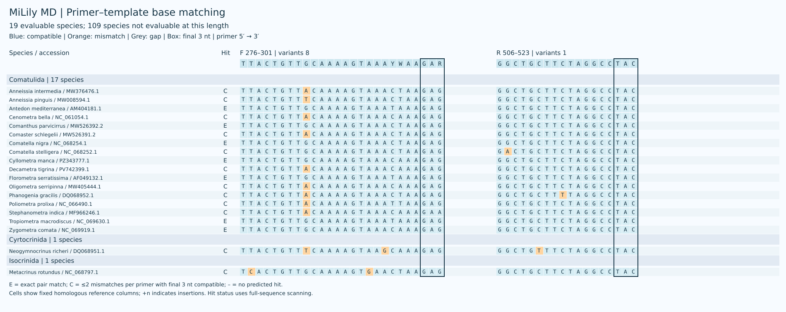
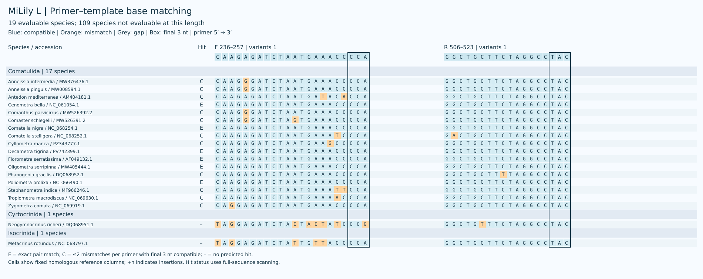
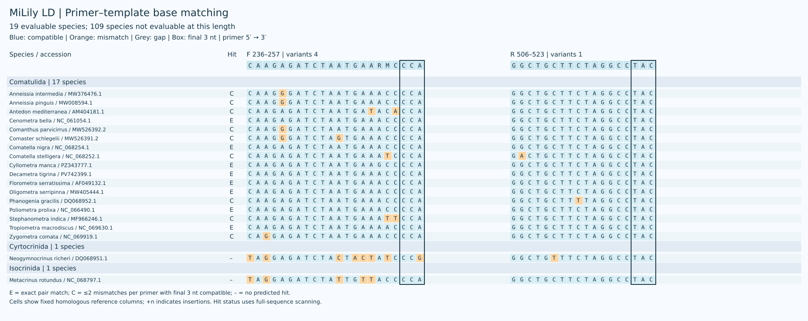
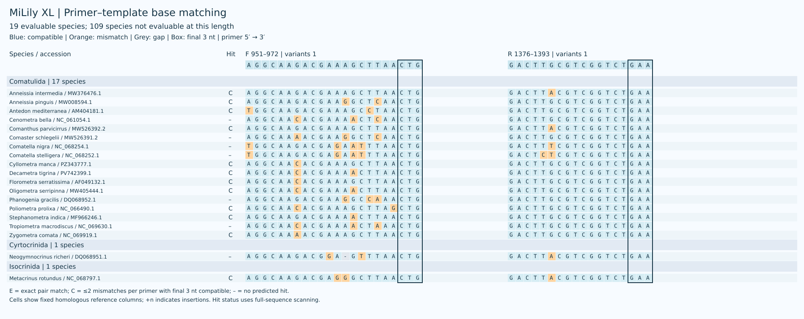
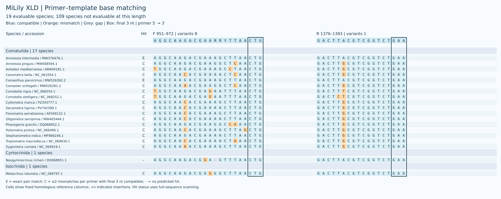

# MiLily

[English](README.md)

线粒体 16S rRNA 环境 DNA 候选引物，包含 XS、S、M、L、XL。S–XL 各保留普通单对及简并单对 D，同长度共享参考坐标；XS 为固定单对。
每个物种保留一条参考序列；主指标对可评价物种等权，各目单列。
海百合参考面板为 128 个物种，但 S–XL 只有 19 个物种可评价；XS 保持原序列并独立评价。

[参考面板 / Reference panel](results/species_qc/panel.csv) · [参考序列审核 / Reference curation](results/species_qc/README.md)

## 预测表现

| Name | Coverage | Exact | Strict WC / GT | WC≤3 / GT≤2 |
|---|---:|---:|---:|---:|
| S | 14/19 (73.68%) | 6/19 (31.58%) | 0 / 0 | 0 / 0 |
| SD | 17/19 (89.47%) | 10/19 (52.63%) | 0 / 5 | 0 / 10 |
| M | 17/19 (89.47%) | 0/19 (0.00%) | 0 / 1 | 4 / 1 |
| MD | 19/19 (100.00%) | 7/19 (36.84%) | 2 / 9 | 13 / 10 |
| L | 17/19 (89.47%) | 6/19 (31.58%) | 0 / 0 | 0 / 0 |
| LD | 17/19 (89.47%) | 8/19 (42.11%) | 0 / 0 | 0 / 0 |
| XL | 12/19 (63.16%) | 0/19 (0.00%) | 0 / 0 | 0 / 0 |
| XLD | 18/19 (94.74%) | 2/19 (10.53%) | 0 / 3 | 4 / 3 |

覆盖要求每条引物最多 2 个错配且末端 3 nt 兼容；完全匹配要求两条引物均无错配。严格 WC/GT 含末端约束；WC≤3 / GT≤2 为宽松非目标筛查。

D 引物每条最多 8 个具体变体，简并位点限于 3′ 半段。XS 是固定命名的特殊单对。计算预测仍需实验验证。

SD 在当前 19 个可评价物种中覆盖全部 17 个 Comatulida，但未覆盖 Cyrtocrinida 和 Isocrinida 的代表。XS 的结构与非目标评估见 [XS 评估](results/xs/assessment.json)。

## XS

| Name | F (5′→3′) | R (5′→3′) |
|---|---|---|
| XS | `TTGGGGCAACCDCGAAG` | `CAACATCGAGGTCGCAAAC` |

XS 图沿用其原参考面板。

## S

| Name | F (5′→3′) | R (5′→3′) |
|---|---|---|
| S | `GATCTAATGAAACCCCAA` | `TATCCCTTTTGGTTTAGC` |
| SD | `GATCTAATGAARYYCCAA` | `TATCCCTTTTRGTTTWGY` |

[S · 各目](results/current_primers/S/S_by_order.csv) · [各物种](results/current_primers/S/S_by_taxon.csv)

[SD · 各目](results/current_primers/S/SD_by_order.csv) · [各物种](results/current_primers/S/SD_by_taxon.csv)

## M

| Name | F (5′→3′) | R (5′→3′) |
|---|---|---|
| M | `TTACTGTTGCAAAAGTAAACTAAGAG` | `GGCTGTTTCTAGGCCTAC` |
| MD | `TTACTGTTGCAAAAGTAAAYWAAGAR` | `GGCTGCTTCTAGGCCTAC` |

[M · 各目](results/current_primers/M/M_by_order.csv) · [各物种](results/current_primers/M/M_by_taxon.csv)

[MD · 各目](results/current_primers/M/MD_by_order.csv) · [各物种](results/current_primers/M/MD_by_taxon.csv)

## L

| Name | F (5′→3′) | R (5′→3′) |
|---|---|---|
| L | `CAAGAGATCTAATGAAACCCCA` | `GGCTGCTTCTAGGCCTAC` |
| LD | `CAAGAGATCTAATGAARMCCCA` | `GGCTGCTTCTAGGCCTAC` |

[L · 各目](results/current_primers/L/L_by_order.csv) · [各物种](results/current_primers/L/L_by_taxon.csv)

[LD · 各目](results/current_primers/L/LD_by_order.csv) · [各物种](results/current_primers/L/LD_by_taxon.csv)

## XL

| Name | F (5′→3′) | R (5′→3′) |
|---|---|---|
| XL | `AGGCAAGACGAAAGCTTAACTG` | `GACTTGCGTCGGTCTGAA` |
| XLD | `AGGCAAGACGAARRYTTAACTG` | `GACTTACGTCGGTCTGAA` |

[XL · 各目](results/current_primers/XL/XL_by_order.csv) · [各物种](results/current_primers/XL/XL_by_taxon.csv)

[XLD · 各目](results/current_primers/XL/XLD_by_order.csv) · [各物种](results/current_primers/XL/XLD_by_taxon.csv)

[Methods / 方法](docs/METHODS.zh-CN.md)

[Validation / 验证](docs/VALIDATION.md) · [Copyright / 著作权](COPYRIGHT.md)
