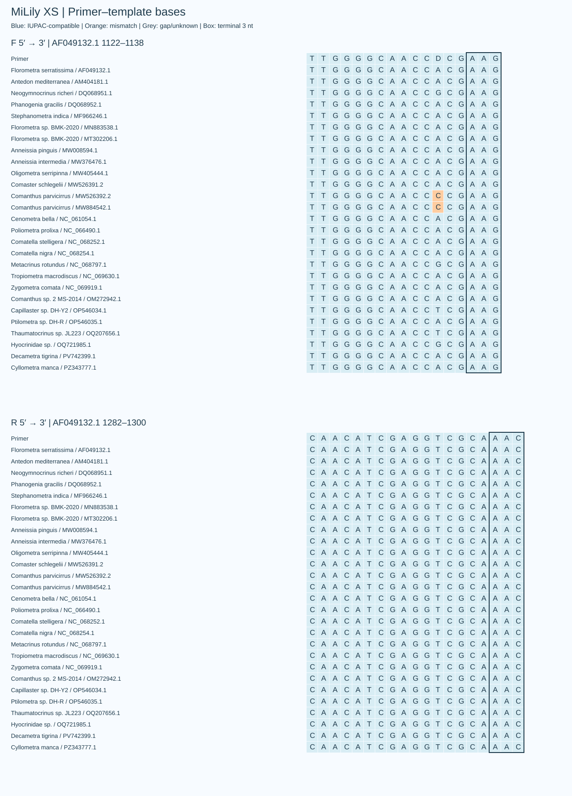

# MiLily-XS / XS assessment

**结论：XS是很有价值的短片段候选。它在现有海百合面板上的覆盖率和完全匹配率优于 MiLily-SD，简并度也低得多；但它有明确的海胆交叉匹配，以及正向引物内部发卡预测，暂不能据此认定是更好的海百合特异性 eDNA 方案。**

F：`TTGGGGCAACCDCGAAG`（17 nt，D=A/G/T，3 个序列变体）  
R：`CAACATCGAGGTCGCAAAC`（19 nt，普通引物）

## 同一数据与规则下的比较

本节保留参考加权口径，当前主指标为[四目等权](D_OPTIMIZATION.md)。/ This section retains reference-weighted metrics; current primary scores balance four orders.

评价面板为现有 MiLily 的 27 条参考、25 个分类标签；先按标签等权，再在标签内等权。覆盖：两端每条≤2个错配且各自末端3 nt兼容；完全匹配：两端均无错配，简并碱基按集合兼容计算。非目标数据库含7,177条非海百合参考记录。命中数是数据库记录数，不是实际扩增比例。

| 方案 | F/R简并度 | 面板覆盖率 | 完全匹配率 | 预测产物bp | 严格非目标¹ | 完全匹配非目标 | 宽松非目标WC3² |
|---|---:|---:|---:|---:|---:|---:|---:|
| MiLily-XS | 3/1 | 100.0% | 96.0% | 159–194 | 18 | 10 | 4196 |
| MiLily-SD | 128/128 | 84.0% | 66.0% | 193–203 | 0 | 0 | 4 |
| MiLily-MD | 96/8 | 100.0% | 92.0% | 245–256 | 10 | 0 | 26 |
| MiLily-LD | 32/8 | 92.0% | 50.0% | 288–297 | 0 | 0 | 0 |
| MiLily-XLD | 72/6 | 96.0% | 70.0% | 443–471 | 3 | 0 | 8 |

¹ 严格非目标：同样要求两端各≤2错配、末端3 nt兼容。  
² WC3：两端各≤3错配，不强制末端3 nt兼容，用于保守筛查；大量候选存在末端错配，不能全当成必然扩增。

[包含普通单对及A/B并集的完整比较](../results/comparison.csv) · [更严格的非目标比较](../results/xs/strict_background_comparison.csv)

## XS的优势

- **短**：面板内159–194 bp；在 Florometra serratissima（AF049132.1）参考上的跨度为179 bp，含引物。正向坐标1122–1138，反向结合区1282–1300（1-based、去gap参考）。
- **匹配好**：27条参考均覆盖；25条完全匹配，对应按标签加权96%。未完全匹配的两条参考均标为 Comanthus parvicirrus，仍符合上述覆盖条件。
- **组合简单**：仅一对、正向3变体、反向1变体。相比MiLily-SD的128/128，合成与浓度分配更容易控制。
- **当前观察到的分辨率可用**：相同25标签面板上，22个标签未出现与其他标签共享完全相同条码的情况（88%），与MiLily-MD同为22/25。该值只是库内观察，不代表未知物种的鉴定成功率。

全269条目标记录的扫描另显示，这个位点覆盖的可用标签比当前MiLily位点多。不同记录有片段缺失，不能直接用全库命中数量比较位点优劣，因此主比较统一使用冻结面板。

## 特异性：少量确定交叉匹配，另有较多宽松命中

严格模型下命中18条非目标：海胆10、海星7、蛇尾1。其中10条海胆参考与两条引物均完全匹配，涉及 Amblypneustes、Holopneustes、Microcyphus。检查确认结合位点位于这些参考的内部，两侧均有序列，并非仅在截取序列末端碰到未剪除的引物尾巴。预测产物184–189 bp，与海百合159–194 bp重叠，无法靠产物大小直接排除。

[完全匹配非目标清单](../results/xs/exact_background_hits.csv) · [这些命中的内部坐标](../results/xs/exact_background_binding_positions.csv)

宽松WC3命中4,196条；允许G–T配对、每条≤2错配的GT2命中3,889条。进一步要求GT模型末端3 nt兼容后，为102条。这些模型用于界定风险范围，不是定量PCR预测。实际共扩增取决于错配位置、聚合酶、退火条件及样本中各类群DNA的丰度。

R序列也曾作为双壳类 Waldo 的16S内引物发表使用。这说明该R序列不是海百合专有序列；整对引物的特异性仍以成对匹配及实验为准。[Valentich-Scott et al., 2013](https://pmc.ncbi.nlm.nih.gov/articles/PMC3713335/)

## 末端与热力学

两条引物的3′端均通过当前MiLily规则：无末端三连、末端3 nt有GC、末端5 nt含1–4个GC；D距离3′端还有5个碱基，不在末端3 nt。正向5′附近有4个连续G，未超过目前连续同聚物≤4的门槛。

按现有参数（单价盐50 mM、Mg²⁺ 1.5 mM、dNTP 0.6 mM）计算：

| 浓度情境 | F的双链Tm范围 | R的双链Tm |
|---|---:|---:|
| 每变体50 nM | 56.7–60.7°C | 57.3°C |
| 每方向总计200 nM | 57.1–61.1°C | 59.3°C |

双链Tm配对合适，但F的三个变体均预测出内部短发卡，发卡Tm约62.6–69.4°C，超过现有MiLily的55°C筛选阈值。结构主要为内部2 bp茎，未把F的3′端纳入茎；在57°C时该预测的ΔG约−0.35至−0.65 kcal/mol。**不能只凭较高的发卡Tm断定PCR失败，也不应忽略它。** 它是当前算法会排除XS的主要结构原因，需要通过实际扩增效率判断。自二聚体预测不是本次主要风险。

[完整热力学结果](../results/xs/thermal.json) · [结构及不同温度的ΔG](../results/xs/structures.json)

## 用途判断

**组织DNA、单个体条形码：值得优先试验。** 短片段、低简并和高完全匹配率都有优势；交叉类群扩增在单个体材料中通常更容易管理，但仍要排除污染。

**混合海洋eDNA：列为有竞争力的短片段候选，与MiLily-SD/MD平行验证。** 它比现有SD更短、面板覆盖更好；MiLily目前的优势是非目标筛查更严格。若海胆DNA较多，完全匹配交叉扩增尤其值得实测。当前证据支持进入验证，而不是直接替换全部MiLily方案。

## 碱基匹配与复核

蓝色为IUPAC兼容，橙色为错配，框线为3′端3 nt。绘图窗口取同源位点附近±5 nt内的最低错配窗口。全部27条参考的覆盖与完全匹配共54项判断，与独立全序列扫描完全一致。另以不限制150–500 bp的宽范围扫描复核，主表结果不变，排除了原长度范围人为漏算的影响。

[逐参考结果](../results/xs/panel_detail.csv) · [复核记录](../results/xs/verification.json) · [碱基表](../results/xs/base_matching.csv)

本比较基于现有参考集和计算模型；没有新增湿实验数据。各模型命中数、匹配图和热力学结果应联合解释。

## English assessment

XS is a fixed 17/19-nt pair with F/R degeneracy 3/1 and predicted products of 159–194 bp. On the shared 27-reference/25-label panel, coverage is 100% and exact matching 96%; the two non-exact references are labelled Comanthus parvicirrus. The primer-inclusive AF049132.1 coordinates are F 1122–1138 and R 1282–1300. XS is the assay name; D in its F sequence denotes A/G/T.

Strict non-target matching (≤2 mismatches per primer, compatible final 3 nt) yields 18 records; 10 sea-urchin records match both primers exactly. Their binding sites are internal, and predicted 184–189 bp products overlap the target range. WC3/GT2 yield 4,196/3,889 records, broader screens that do not imply that every hit amplifies. XS therefore does not pass the S–XL background gate.

Terminal rules and duplex-Tm compatibility pass. F variants predict internal two-base-pair hairpins with Tm 62.6–69.4°C, above the 55°C S–XL gate; their 3′ ends are outside the stem. At 57°C, predicted hairpin ΔG is approximately −0.35 to −0.65 kcal/mol. This is an experimental risk, not proof that PCR fails. XS is retained as a candidate, with explicit structure/background-gate flags. The remaining S–XL sequences and A/B coordinate rules continue to apply to their own four windows.

XS is attractive for tissue barcoding and worth parallel testing with SD/MD for mixed marine eDNA. On the common panel, 22/25 labels lack observed shared barcodes, the same as the pre-optimization MD. No new wet-lab validation is claimed. Independent local target predictions and Python bit-parallel background predictions agree with exhaustive C++ scanning (54 target decisions and two background sets for XS).
